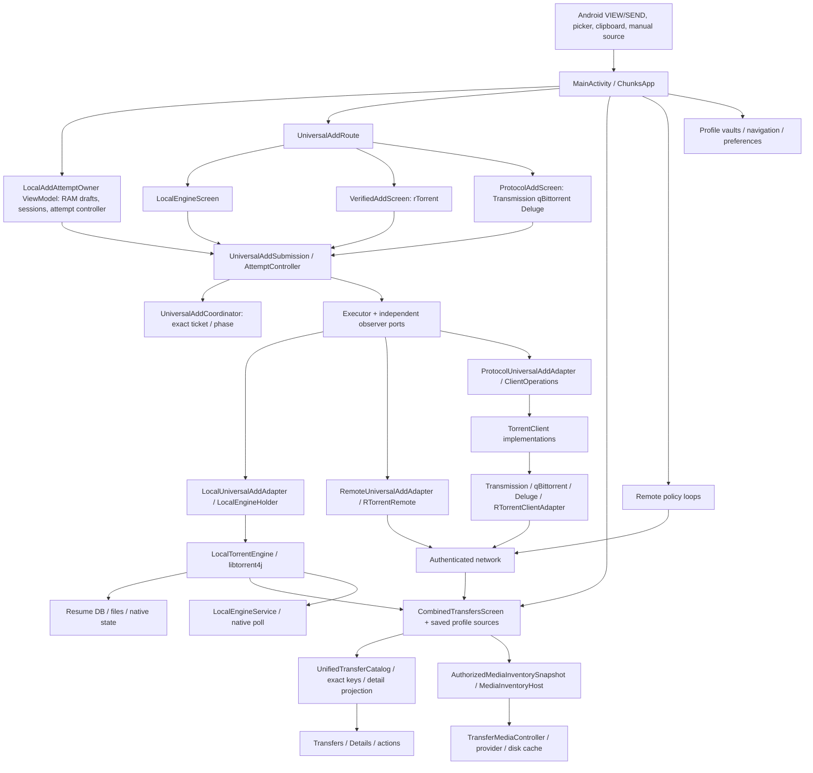

# Chunks forensic engineering audit — 2026-11-23

**Status:** Independent, source-grounded audit checkpoint. Substantial repository-wide inventory and targeted code/CI investigation; **not an exhaustive line-by-line or runtime qualification**. This dated artifact is advisory evidence, not a normative specification, another active backlog, a release certificate, or permission to change owner requirements.

**Audited main:** [bf5d5bf34fbd00f78351aeedd1ebf58df2dc44f5](https://github.com/gamesbyian/Chunks/commit/bf5d5bf34fbd00f78351aeedd1ebf58df2dc44f5), Git tree efeb3bd84ed9fb1b13b00b56c7781bed7dae44ee; #2021, Make Local Share failure evidence exact and private. Snapshot taken 2026-11-23 (owner-local date). Open PRs at observation: #2023 native-delete APK reuse (165f4a63), #2022 owned MediaStore multi-file copy (5eb22e2a), #2019 in-flight Add reads fenced to exact connection (f1c46602), #1980 status-bar contrast (41d0bfeb). These are excluded from the audited source tree. No application, tests, workflows, specs, live servers, or production data were modified by the audit. No owner PC or Desktop Commander used. Visual specimen atlas is deferred by owner instruction.

## 1. Executive assessment

**Continue on the existing foundations, but interrupt unchecked accumulation of orchestration.** Chunks is an unusually ambitious single Android application: an actual native torrent engine, multiple independently authenticated remote engines, shared inventory and user operations, recovery, filesystem publication, media enrichment, automation and privacy. Much of the defensive complexity serves real irreversible-operation requirements. The strongest foundation is the exact environment/hash identity, typed operation outcomes, shared one-shot Add coordinator, real-engine integrations and explicit proof boundaries. Those are valuable assets, not architectural debris.

The dominant weakness is that responsibility boundaries in the source remain considerably less mature than the safety contracts. The root package contains nearly half the production Kotlin bytes; three enormous UI files own app routing, storage, credentials, live inventories, orchestration, scheduling and details. Shared domain logic exists, but a shared form or route is not a shared state owner. Remote command semantics are also inconsistent at the edges: filtered views can be used as exact absence, adapter errors can swallow cancellation, and generic success receipts can claim stronger effects than observed. These are specific, actionable issues, not a verdict that the app is unsafe in all circumstances.

Runtime engineering is mixed. Single-flight native observation lanes, bounded reads and explicit staleness protect responsiveness; repeated full inventory polling, policy sweeps and unstructured blocking bridges are credible costs. No CPU, battery, network traffic, startup, memory, installed-size or scaling benchmark was performed for this audit. Do not turn those hypotheses into measured regressions.

Tests are extensive and several reviewed suites assert genuinely difficult invariants. Evidence infrastructure is comparatively sophisticated. CI is expensive on shared hot paths, and historical fixes already addressed some obvious waste. The long five-client workflow primarily spends time in its installed journeys, not Gradle. A further speed-up requires phase-level evidence and independent verification, not indiscriminate test deletion. Documentation authority is thoughtfully specified but stale historical language remains in active contracts.

| Dimension | Assessment |
|---|---|
| Architecture | Viable domain seams; immature ownership and enforcement at UI/runtime boundary. |
| Maintainability | Concentrated hotspot debt; many small pure helpers are useful. Avoid a wrapper-per-fix approach. |
| Correctness | Strong intent/readback primitives; confirmed contract defects at some adapters and outcome presenters. |
| Reliability | Deliberate native and remote failure containment; non-Add mutation lifetime and automation need scrutiny. |
| Security | Good visible baseline (Keystore, TLS policy, redaction, account fences); not a completed security review. |
| Performance | Known redundant work opportunities in source; magnitude unmeasured. |
| Testing | Real negative controls and installed journeys are strengths; adapter contract and lifecycle gaps remain. |
| Extensibility | New remotes share a typed interface, but cross-client feature changes still touch parallel paths. |
| Development efficiency | Recent CI batching improved the system; hot-file contention, multiple proof builds, and status-document upkeep remain costs. |

## 2. Evidence, size, and methodology

Used authenticated GitHub API/contents inspection with the commit pinned, complete recursive tree metadata (not truncated), targeted full-file reads and exact numbered slices, lexical counts, PR/commit archaeology, recent workflow-run metadata and a job-step timing sample. Links below are relative to the repository except where an external GitHub run/PR is named; all line numbers refer to the audited SHA, not future main. Main source shorthand **P = app/src/main/java/io/github/gamesbyian/chunks/**; JVM test shorthand **T = app/src/test/java/io/github/gamesbyian/chunks/**. These are exact prefixes, not hypothetical packages.

The execution environment could not resolve github.com for a git clone; authenticated file and tree access worked. A complete checkout, compiler call graph, whole-repository reference index, Gradle dependency resolution, lint, builds, tests, emulator, live engine measurements, full history scan and binary/APK inspection were not performed. Do not interpret a successful existing CI run as a new test performed by the auditor. Lexical counts include comments/imports and are hotspot indicators rather than AST complexity metrics.

### Repository inventory

3,161 tracked blobs. Counts and uncompressed Git blob bytes from tree metadata:

| Surface | Files | Bytes |
|---|---:|---:|
| Production Kotlin | 438 | 4,055,422 |
| JVM Kotlin tests | 596 | 3,922,474 |
| Android instrumentation Kotlin tests | 186 | 1,574,570 |
| Shared Kotlin test helper | 1 | 8,609 |
| Debug Kotlin | 2 | 10,642 |
| Production non-Kotlin resources/config | 32 | 1,085,146 |
| docs | 1,080 | 21,010,117 |
| assets | 182 | 37,884,011 |
| tools | 206 | 1,201,887 |
| tests (repository Python/etc.) | 73 | 449,916 |
| skills | 185 | 1,173,638 |
| .github | 102 | 470,441 |

JVM plus installed Kotlin tests contain ~1.36 times the production Kotlin bytes. That is neither coverage nor a defect. Binary/design assets are Git size, not APK size. The 893 design files include 847 SVG inventory files; there is no evidence they are packaged in the APK. Root docs: 124 files, ~3.75 MB; archived docs: 24 files, ~0.51 MB; design ~15.13 MB, research ~1.27 MB, evidence ~0.34 MB. Preserve canonical owner reference assets.

Production package distribution (files/bytes): root 191/1,989,045; rpc 40/484,808; media 43/407,057; model 64/337,974; snapshots 38/313,824; engine 28/281,231; create 6/59,420; storage 10/59,154; seeding 6/55,570; privacy 7/42,667; exports 2/10,203; routing 1/8,629; discovery 1/3,916; organize 1/1,924.

| Hotspot P-relative | Lines | Blob bytes | Lexical indicators |
|---|---:|---:|---|
| MainActivity.kt | 5,083 | 298,177 | 238 lines containing remember; 30 LaunchedEffect; 33 catch; 30 Dispatchers.IO |
| LocalEngineScreen.kt | 4,528 | 280,138 | 161 remember; 35 LaunchedEffect; 84 catch; 52 Dispatchers.IO |
| CombinedTransfersScreen.kt | 2,698 | 155,724 | 83 remember; 27 LaunchedEffect; 19 catch |
| engine/LocalTorrentEngine.kt | 2,666 | 142,757 | 48 synchronized( lines; 19 @Synchronized; 74 catch |
| rpc/RTorrentRemote.kt | 2,584 | 138,880 | 97 catch; 7 delay( lines |
| VerifiedAddScreen.kt | 1,566 | 91,596 | 38 remember; 17 LaunchedEffect |
| media/TransferMediaController.kt | 1,188 | 76,594 | 21 synchronized( lines |
| ProtocolAddScreen.kt | 630 | 36,681 | 28 remember |
| snapshots/LocalSnapshotRestorePreviewPanel.kt | not counted | 75,746 | size-only |

First three account for 734,039 bytes, **18.1% of all production Kotlin**, first five ~25.0%. File size alone is not the defect; their mix of lifetimes, I/O, UI state, and command authority is. LOC totals and true duplication/cyclomatic complexity are not established.

### Coverage record

**Thorough for stated narrow question:** entire tree inventory, Gradle module count, hot-file concentration, Add route/owner/controller/coordinator split, exact typed remote read/absence/cancellation and generic outcome path, selected local polling/service ownership, selected CI build/artifact/step timing and documentation authority contradictions.

**Partially examined:** Local engine/restore and synchronization (symbols and selected implementation; not every JNI call), remote authentication and capabilities, rTorrent adapter and legacy RPC boundaries, Transmission/qBittorrent/Deluge command/read mapping, combined inventory projection, remote seeding/Finish in Order scheduling, media controller/host/cache, manifest/intake/TLS, credential persistence, representative test suites, workflow routing and acceptance policy, snapshot/storage file inventory, 35 recent commits, 60 recent run records (not all runs), current open PR/issue list and selected active documents. Some full files were processed for symbols/counts with only relevant slices reviewed in detail.

**Not sufficiently examined:** full reference/use graph; every source/test/resource; C++/JNI dependency internals; all snapshot journals and archive/copy collision/recovery paths; SAF/MediaStore authorization and deletion end to end; all RPC methods and provider-specific redirects; DB corruption/fault recovery experiments; every settings store/manifest entry; all 100-ish workflows and their artifact logs; branch-wide churn/blame and historical PR diffs; supply-chain vulnerability scan; physical handset/accessibility/Doze tests; production signing/release upgrade, dependency graph, APK size, runtime performance. Deletion estimates and final essential-versus-avoidable fraction remain unresolved. Do not describe this checkpoint as completed exhaustive coverage.

## 3. Actual architectural map

Gradle settings.gradle.kts:15–16 includes only :app. Package boundaries are conventions, not independently compiled dependency barriers. The Android app depends on Compose Material3/foundation, coroutines, libtorrent4j (arm64 and x86_64), platform storage/Keystore and transport implementations. Local native and remote engines do not share a low-level protocol.

Arrows express actual control/data relationships at a useful granularity, not compiler-enforced package dependencies. Problem boundaries: UI hosts both rendering and business effects; rTorrent direct RPC and shared TorrentClient paths overlap; multiple native inventory consumers independently read the engine; protocol operation factories/session lifetime are not demonstrably shared with the policy loop; engine, app and readback evidence have different authority.

### Execution traces

**Intake and Add:** AndroidManifest.xml:31–35 exports singleTask MainActivity (necessary intake; not an exported command API). P/ExternalAddSource.kt:30–112 classifies source; P/MainActivity.kt:134–188 retains incoming source and drafts in a ViewModel; 205–334 Activity intake/lifecycle; ChunksApp:405 onward manages source/destination and callbacks; 1441,1474,1604 instantiate the three adapters; 2063 dispatches P/UniversalAddRoute.kt:24–57. Each screen performs preparation; P/UniversalAddSubmission.kt:52–114 admits and freezes an executor through P/UniversalAddAttemptController.kt:57–215. P/model/UniversalAddCoordinator.kt:132–464 holds ticket/phase/verification logic; P/LocalUniversalAddAdapter.kt, P/rpc/RemoteUniversalAddAdapter.kt:81–403, P/rpc/ProtocolUniversalAddAdapter.kt:68–192 retain engine-specific execution/readback. Source-sensitive data stays RAM-only intentionally; process death cannot authorize resend. Original source, Add job and backing payload are distinct entities. This is genuine convergence at transaction level, incomplete convergence at preparation/orchestration level.

**Transfers:** P/CombinedTransfersScreen.kt:388–448 accepts a host of callbacks/states; :615–700 independently polls native inventory and qualifies privacy; P/CombinedReadOnlyProtocolSources.kt:128–202 reads saved protocol profiles; P/RemoteProtocolCombinedProfiles.kt:15–75 verifies exact backend/profile and constructs independent operation factories. P/model/UnifiedTransferCatalog.kt:12–121 defines exact identity, snapshots, freshness, filter/order; :136–228 normalizes, selects and sorts. Engine remains authoritative for transfer state; unified list is read projection, not write authorization. Local and historical rTorrent inventories/catalog models still exist; no dead-code claim without usage graph.

**Mutation:** shared typed remote calls P/rpc/TorrentClient.kt:23–91 -> P/rpc/ClientOperations.kt:127–340 -> backend transport -> independent readback -> P/ProtocolClientOperationsPanel.kt:195–233/430–454. Legacy rTorrent and Local paths retain independent operation semantics; protocol capabilities legitimately differ. P/RTorrentRemote.kt is much more than a transport: domain outcomes, probes, list/read, command and readback. Its own rich delete/start/priority receipts must not be flattened into ACK.

**Native and background:** P/LocalEngineScreen.kt:150–235 contains process singleton, startup and preference transactions; local screen observes at 1s (:836–905), combined screen also at 1s when mounted; P/LocalEngineService.kt:33,146–157,244–283 performs 2s poll, Finish in Order, Smart Seeding and notification, with separate command lane. P/engine/LocalTorrentEngine.kt manages JNI/native session, collision, locks and resume; P/engine/LocalResumeDatabase.kt:93–170 uses SQLite with explicit non-destructive corruption policy. MainActivity.kt:1731–1829 owns 30s remote automation loops.

**Media and security:** app-hosted media lifecycle (MainActivity.kt:290; P/media/MediaInventoryHost.kt:45–97), authorized inventory session (P/media/MediaInventoryEnrichmentSession.kt:61–139), P/media/TransferMediaController.kt:127–205 recognizes and resolves file evidence, caches per exact transfer, settings and provider calls. P/RememberedRemoteLogin.kt:132–177 and P/RememberedRemoteProtocolProfiles.kt:88–131,212–232 use AES-GCM/Android Keystore. AndroidManifest.xml:16–19 disables backup, network_security_config.xml:3–10 disallows cleartext except literal loopback, P/TorrentLinkImport.kt:154–253 has bounded HTTPS/redirect rules. These are observed mechanisms, not proof every call honors policy.

## 4. Findings register

Severity denotes practical impact if encountered; confidence refers to source evidence, not frequency. **P0** before expanding affected mutation; **P1** next development batch; **P2** incremental/planned; **P3** optional. Estimates are focused engineer/agent implementation effort, excluding runner queue and required acceptance time. Risk is regression risk, not defect severity. Every finding names evidence and an acceptance gate; runtime frequency is unknown unless measured.

### FE-01 — Exact typed remote read conflates unexpected identity with authoritative absence
**Confirmed contract defect; high severity / high confidence; P0.**
Evidence: P/rpc/TorrentClient.kt:23–37 explicitly says exact read returns null only when client verifiably lacks job. P/rpc/TransmissionClient.kt:56–60, P/rpc/QBittorrentClient.kt:71–75, P/rpc/DelugeClient.kt:82–86 filter returned rows to the requested hash and return singleOrNull. A nonempty response containing exclusively another valid hash becomes null rather than an invalid response. Underlying parsers validate length/duplicates (Transmission:200–215, Deluge:258–273, qBittorrent:232–248) but not requested identity. P/rpc/ClientOperations.kt:334–340 translates null to Read.Absent; wrong identity guard is bypassed. Read.Absent can satisfy delete at :205–207/309–327. A malformed/stale server response can falsely confirm removal or allow duplicate preflight; no evidence that ordinary servers frequently do this, and no wrong-account write demonstrated.
Root: collapsing invalid/unknown/absent at adapter boundary. Fix a single exact-result validator or explicit sealed ExactRead type across three typed adapters; empty from a documented exact query may establish absence; unrelated or mixed rows fail closed, never a replay. Validate hex hashes with existing ClientHashes utility where appropriate, avoid a second identity language.
Benefit: reliable negative evidence across Add/remove/recheck and file operations. Effort 0.5–1 day; risk low/moderate. Depends on shared adapter contract, not UI changes. Verify parameterized real-wire fake cases: empty, wrong-only, mixed, duplicate, malformed, correct; before write zero calls when failed, after write no false Verified; disposable three-client positive/negative proof. Include rTorrent separately (FE-02).

### FE-02 — Shared rTorrent adapter uses a filtered list as exact command evidence
**Confirmed structural contract mismatch; high severity / high confidence; P0 where reachable, otherwise P1.**
P/rpc/RTorrentClientAdapter.kt:52–62 implements torrents() and torrent(hash) using remote.listTransfers("main"); a missing row is treated absent. TorrentClient.kt:23–37 promises complete inventory and exact absence. rTorrent "main" may be filtered; the project already addressed this in snapshot comparison [#1931](https://github.com/gamesbyian/Chunks/pull/1931) (historical acceptance must be independently rechecked for this different path). This is not proof that the primary direct rTorrent Add path has the same defect. Adapter consumers and reachable command paths need enumerating before release severity broadens. Full inventory per exact lookup is also disproportionate network work.
Root: using UI-oriented inventory as command authority. Reuse actual exact d.* read with distinguishable not-found vs transport/refusal and the existing complete default-view inventory semantics; keep capabilities of legacy/modern rTorrent and existing rich receipts. Effort 1–2 days; medium risk. Depends on FE-01 contract. Test hidden job in main, incomplete default view, missing exact job, unknown RPC, legacy/modern server, no unintended mutation. Audit ClientJobTransfer/Move and snapshot usage, not only Add. Do not substitute view selection as authorization.

### FE-03 — Cancellation translated into normal fallback or I/O errors in adapter reads
**Confirmed source defect; medium/high severity / high confidence; P1.**
P/rpc/QBittorrentClient.kt:48–67 catches CancellationException explicitly in export branch, then :62 catches all Exception and returns null for fallback request. :78–82 catches IOException, then other Exception -> IOException; :206–220 uses catch-all and runCatching around suspend calls. :285–304 request explicitly rethrows cancellation, so outer wrappers undo that contract. P/rpc/RTorrentClientAdapter.kt:23–49 similarly uses runCatching around suspend reads. Consequence: cancellation may be presented as absence/unavailable, produce inappropriate fallback reads, or mask lifecycle cancellation; no proof of a subsequent unauthorized write.
Root: synchronous exception-handling idiom applied to suspension. Use explicit cancellation rethrow; limit catch scope to parsing, classify transport/unsupported separately. Search all suspend-containing runCatching and catch(Exception) with AST or manual traces; avoid blind replacements in synchronous native cleanup. Effort 0.5–2 days; low/moderate risk. Parallel with FE-01 only if file ownership coordinated. Verification fake suspending wire cancels at every request/parse/fallback boundary, assert CancellationException propagates and no extra call; installed navigation/reconnect negative controls.

### FE-04 — Generic recheck and deletion outcome overstates the verified effect
**Confirmed recheck wording mismatch; deletion proof gap; high for destructive outcome, medium for recheck / high confidence in inspected paths; P0/P1.**
P/rpc/ClientOperations.kt:205–207 removeChecked verifies registration absence for both job-only and data deletion; :222–227 recheck explicitly says presence is the only honest postcondition. P/ProtocolClientOperationsPanel.kt:66–72 generic Verified text is "action: confirmed on client"; :229 sends Recheck, :430–452 sends Remove and delete files. TransmissionClient.kt:119–120 sends delete-local-data; DelugeClient.kt:147–149 and QBittorrentClient.kt:164 have their backend calls; no independent backing-file verification in shared readback. RTorrentClientAdapter.kt:110–123 recognizes a pending filesystem effect, which is a stronger semantic distinction. Ordinary clients may perform deletion synchronously; prove upstream behavior before adding a complex filesystem integration. Current wording may be read as confirmation of a completed check or data deletion when only registration/acceptance is known.
Root: generic Verified has operation-dependent postconditions, UI discards that distinction. Use typed effect/proof level (accepted, check observed, job removed, data deletion requested/verified); avoid implying verified pieces or files from RPC alone. Preserve explicit delete confirmation and real operation semantics, no new universal filesystem API. Effort 1–2 days; moderate risk. Depends on exact absence FE-01/02. Test accepted recheck that never runs, fast check, async cleanup, lost reply, shared files and actual file readback where provider supports it. Distinguish scope-limited release issue from whole-app blocker.

### FE-05 — Protocol non-Add write lifetime and uncertain latch are screen-owned
**Confirmed ownership weakness; consequential defect scenario not executed; high severity / medium-high confidence; P1.**
P/ProtocolClientOperationsPanel.kt:113–125 uses rememberCoroutineScope, remember(hash) busy, notice, uncertainAt and confirmation; :195–206 sets busy, launches, rethrows CancellationException without a finally and sets latch only for returned Uncertain. If composition is removed after a write is dispatched, the scope is cancelled and remembered latch disappears; a remount may have no record of an ambiguous effect. A different profile with same hash may also share state if caller composition key is insufficient (not established; trace caller before claim). The Add path already solved a similar lifetime with ViewModel owner and exact tickets. Do not assume all Local/rTorrent actions have this defect.
Root: presentation owns command lifecycle. Introduce a narrow app-owned per-exact-client operation fence/receipt for ordinary protocol mutations, without a second generic Add executor; preserve fresh independent readback before reauthorization and distinguish explicit user repeat from automatic replay. Effort 2–4 days; medium/high risk. Depends on FE-01 and shared session-generation contract; coordinate with active #2019. Test cancellation before dispatch, during response loss, after dispatch before readback, navigation, rotation, lock/forget/reconnect, same hash in two profiles, concurrent automation. UI still cancels disposable reads and dialogs.

### FE-06 — Three root Compose hosts concentrate unrelated lifetimes
**Demonstrated structural weakness; high impact / high confidence; P1.**
P/MainActivity.kt (5,083 lines) contains Android lifecycle, retained state, connection, intake, navigation, policy, route construction and details; ChunksApp:405 onward contains hundreds of remembers/effects. P/LocalEngineScreen.kt (4,528 lines) includes process-wide LocalEngineHolder:150–235, huge function parameter surface :288–382, Add, Options, inventory and file operations. P/CombinedTransfersScreen.kt:388–448 accepts many nullable callbacks, caller-owned mutable states, default implementations and reads. Top three are 18.1% of production Kotlin bytes. AGENTS.md:17 explicitly acknowledges shared hot file CI fanout; WORK-QUEUE.md:16 serializes edits. This is direct development bottleneck evidence independent of runtime speed.
Root: evolutionary screen-first integration with callback lifting rather than explicit feature/runtime ownership. Extract behavior boundaries, not arbitrary visual chunks: connection/session registry; intake/draft owner; inventory observer; policy scheduler; pure render state and events. First extract process singleton/startup to engine runtime without behavior changes, then intake and policy ownership, then split UI. Retain existing state types where coherent; avoid a new DI framework, multiple catalogs or blanket Gradle modularization. Effort 5–10 days in separately qualified vertical slices; medium/high regression risk. FE-05, FE-07, FE-09 inform boundaries. Verify unchanged exact Add/Move/navigation/retained state/Options/accessibility and real peer data, plus reduced root dependencies and file-touch counts in subsequent PRs. This should precede major new UI/backend expansions but not block isolated native reliability or protocol fixes.

### FE-07 — Shared Add transaction is real; screen preparation still has three owners
**Demonstrated structural weakness and migration residue; high impact / high confidence; P1.**
P/UniversalAddRoute.kt:24–57 delegates three distinct composables; P/MainActivity.kt:134–178 retains LocalAddAttemptSession, RemoteAddSessions and ProtocolAddAttempt plus common attempt controller. P/LocalEngineScreen.kt:380,610–611, P/VerifiedAddScreen.kt:130,163, P/ProtocolAddScreen.kt:193,207 allow optional injected controllers and composition-owned fallbacks. P/ProtocolAddScreen.kt:60–153 adds its own fingerprint/claim/coordinator map; LocalUniversalAddAdapter.kt:201–278 has retained local session; P/rpc/RemoteUniversalAddAdapter.kt and P/rpc/ProtocolUniversalAddAdapter.kt adapt genuinely different readback. #1996 reviewed source switch and #2019 currently fences in-flight source reads. Thus shared submission lifetime exists; draft, source selection, folder/preparation and per-route outcome logic remain parallel. Optional stand-alone fallback is not inherently unused (may support tests). Do not remove it by grep alone.
Root: shared transaction introduced without fully converging preflight and UI state. Make one retained source/review state with exact selected client and generation; one presentation state/event pipeline; per-client capabilities/Place/preflight and observer implementations remain separate. Consolidate common source-read invalidation, intent construction, original-document retirement, receipt display and navigation; remove obsolete route-local owners only after all call sites/test fixtures migrated. Effort 3–6 days, high risk; stage after #2019 resolution, FE-01/05, extract FE-06 boundaries. Verify full five-client installed Add with source switches, signed HTTPS, Open With, clipboard, opt-out, duplicate, post-write fault, stopped/start and rotation; no wrong-target fallback. Preserve exact account-specific readback and no secret persistence.

### FE-08 — File layout comparison allows arbitrary suffix matching
**Confirmed permissive contract; medium/high potential severity / high confidence in code, low confidence of ordinary occurrence; P1.**
P/rpc/ClientOperations.kt:344–358 ClientFileLayout.match associates rows by index and accepts equal paths or either string ending with slash plus the other. The comment allows variation in one top-level prefix. The implementation also accepts arbitrary depth, e.g. nested/a/file versus file, and a duplicate client index can be overwritten by associateBy. A malformed or changed client file list can pass a broader test than intended, then skip or prioritize the wrong file. Index and infohash constraints reduce practical risk; no actual mismatch observed.
Fix only after recording each client's real metainfo/file path conventions, including single/multi-file. Allow precisely defined root prefix, reject duplicate indices, ambiguous/noncanonical components; retain exact identity and index. Effort 0.5–1 day; medium risk; independent of UI and FE-06. Verify nested paths, duplicate indices, legitimate root/no-root variants on all supported clients; real installed skip/priority Add.

### FE-09 — Separate native full-inventory readers and screen-owned periodic persistence
**Confirmed repeated work in source; runtime cost unmeasured; medium impact / high confidence; P2, sooner if benchmark shows cost.**
P/LocalEngineScreen.kt:836–905 polls engine.list every 1s and selected files, saves resume data every 30 ticks when admitted. P/CombinedTransfersScreen.kt:615–663 separately polls engine.list every 1s with its own pump. P/LocalEngineService.kt:33,146–157,244–283 polls every 2s and independently reads the list for notification/policies. Screen mounting determines overlap; do not claim both screens always run. With foreground service plus one visible screen, duplicate JNI inventory is possible by design. P/LocalScreenObservationPump.kt:19–52 prevents backlog; mutation revision :65–108 protects stale samples. A blocked JNI read must not block stop-command lane; preserving this is mandatory.
Root: observation consumers own sampling. One engine-runtime read model with monotonic accepted revisions, scoped detail queries, freshness policy and subscription-driven cadence; share one snapshot between UI and service only when equivalent and current. Move resume scheduling to engine/service lifetime only after proving existing durable-save policy. Do not merge urgent command lane into potentially stuck poll. Effort 2–4 days; high risk native lifecycle, depends on FE-06. Verify same-hash stale sample cannot unlock mutation, foreground/background/rotation, native blocked read, service deadline, restart, idle/active and large queue. Measure list() calls, JNI wall/CPU time, allocation, notification and resume writes before and after.

### FE-10 — Protocol policy scheduler performs periodic session/inventory work even with no eligible Finish in Order rules
**Demonstrated unconditional code path; high scaling concern / high confidence in logic, unmeasured cost; P1/P2.**
P/MainActivity.kt:1795–1829 caches one ClientOperations per profile in LaunchedEffect keyed only by list of IDs; every 30s calls RemoteSeeding.tickProtocol, then ops.session(), then full ops.client.torrents() if priorities supported, then store.get for each started transfer. No prior check for any active Finish in Order rule in this loop. Saved factory closures from P/RemoteProtocolCombinedProfiles.kt:15–75 may change under same profile ID, while the captured loop and cached client do not restart. Same-ID credential refresh/factory rotation is a plausible stale-session case; exact identity is not necessarily credential generation. Privacy and arbitration with simultaneous UI operations need proof; do not label a credential leak or wrong-account mutation without reproduction. P/seeding/RemoteSeeding.kt:22–130 bridges suspend RPC with runBlocking, and ProtocolSeedingPort.details/observe both call seedingFacts for the same hash, potentially duplicating requests. Shared seeding controller/journal is valuable.
Root: periodic policies hosted by composition, synchronous engine port adapted with blocking coroutine bridges, inventory-driven instead of indexed-rule-driven. First gate off work when no active policy; use exact live session generation with latest factories and revocation; unify per-client policy tick with command authority; cache facts only within a safe tick, batch eligible reads if server supports it. Move remote ports toward suspend only if cancellation/ordering can be maintained; native sync port need not be rewritten. Effort 2–5 days; medium/high risk; FE-05/06. Verify no network for disabled policies, same-ID reauth, forget and lock behavior per normative policy, stop journal once, explicit user restart, parallel UI operation, multiple clients. Measure calls per minute at 0/1/10 rules and 100/1,000/10,000 jobs. Preserve server-derived ratio/time and legitimate protocol differences.

### FE-11 — Catalog and media work scale with inventory size
**Structural scaling risk; medium impact / medium confidence; P2 benchmark first.**
P/model/UnifiedTransferCatalog.kt:181–228 selects, flatMaps, filters, then sorts/groupBy and flattens anew per query; O(N log N) sort is normal, but repeat cost depends on caller invalidation. P/media/TransferMediaController.kt:127–131 store.all maps confirmed titles, :183–205 synchronized observe recognizes input and launches per changed observation; cache is bounded for UI state (:134–139); ArtworkDiskCache.kt:121–132 enumerates files for size/trim. No proof excessive recomposition, cache hit rate or main-thread overhead. P/media/MediaInventoryEnrichmentSession.kt:61–139 has revocation and catch-up rather than naive restart, a positive design.
Root: possible full projection/lookup rebuild on frequent snapshot changes. Measure first: 100/1k/10k/50k jobs, no change vs 1% change, scroll/search, artwork off/on and cold/warm cache. Use trace counters for projection/sort, recomposition, file scans, provider requests and allocation. If significant, memoize immutable snapshot/query revision or update indexes incrementally, conflate duplicate observations, use bounded work keyed by exact job. Do not invent a second authoritative DB, remove consent or make stale results live. Effort 1–2 days benchmark then 2–4 days conditional changes; medium risk, FE-09/10 may already reduce work. Verify exact same sorting, grouping, unknown/partial states, privacy revocation and title search.

### FE-12 — Native engine and rTorrent transport domain concentration require surgical boundaries
**Structural weakness; medium/high impact / high confidence; P2.**
P/engine/LocalTorrentEngine.kt:225–2666 contains native handle ownership, locks, recovery, admission and persistence; 48 synchronized( and 19 @Synchronized lexical lines, 74 catch lines. P/rpc/RTorrentRemote.kt:1–2584 defines numerous receipt types and transport plus behavioral operations, 97 catch lines. Large native/legacy protocol engines are expected to be complex. Arbitrarily separating lock-protected logic into repositories or one-method wrappers can break invariants. No particular deadlock is demonstrated.
Root: accumulated domain and infrastructure responsibilities share one physical implementation. Map lock order/JNI callback and I/O ownership; extract pure validation/receipt projection first, then transport versus command policy with single authoritative owner. Reuse actual upstream native semantics; preserve POSIX workaround, stopped restore, immutable resume and independent filesystem receipts. Effort 3–6 days staged, high risk; after FE-01/02/09; not a blanket rewrite. Verify same lock order and fault injection, Android 29/35 storage, peer bytes, restart/collision and legacy/modern rTorrent. Prefer leaving proven internals alone unless measurable benefit.

### FE-13 — Credential stores are parallel and migration semantics need explicit owner decision
**Structural weakness; medium impact / high confidence in parallel implementation; P2.**
P/RememberedRemoteLogin.kt:132–177 uses encrypted preference record; P/RememberedRemoteProtocolProfiles.kt:88–131,212–232 encrypts roster with separate key helpers; RemoteCredentialLock generation protects writes. Keystore is appropriate. P/RemoteProtocolCombinedProfiles.kt constructs clients from exact credentials. Manifest backup disabled. There is no demonstrated plaintext secret storage or transport vulnerability. Distinct legacy login and typed rosters create maintenance burden and possible inconsistent invalidation/forget flows, particularly in same-identity reconnect.
Root: older single account store extended through additional backend families. Unify a profile/session repository contract (not necessarily the physical schema), retain independent keys if needed and prove deletion/reauth. Do not migrate or delete existing data without an explicit upgrade strategy. Effort 2–4 days, high risk credentials; depends FE-05/10. Test failed decrypt, revoked keys, concurrent forget/save, process death, transient vs saved profile, exact Deluge daemon identity, no logs or backup leakage. Confirm documented clean development install vs future release update expectations before migration.

### FE-14 — CI cost concentrates in installed journeys and independent build setup
**Measured cost, improvement opportunity; medium/high impact / high confidence; P1.**
Live 60-run sample: [45308941963](https://github.com/gamesbyian/Chunks/actions/runs/45308941963), failed five-client campaign on c616bed2, one job 21 min. Step times: checkout 2s, harness syntax ~0s, daemons 25s, Gradle setup 12s, SDK 6s, app/test compile 210s, emulator prepare 5s, installed journeys/post-write fault 991s, artifact 1s. ~79% elapsed in installed/emulator step, ~17% compile. Step includes emulator boot; cannot separate boot versus tests without phase log. Other five-client runs: [45305301520](https://github.com/gamesbyian/Chunks/actions/runs/45305301520) success 18 min; [45297926971](https://github.com/gamesbyian/Chunks/actions/runs/45297926971) success 19 min. These are approximate run wall times from timestamps, not billed runner minutes. At c616bed2 foundation 11 min, native Add 13, R8 9, magnet 9, combined 9, delete 5, docs <1 and atlas skipped; distinct jobs can overlap. They are not interchangeable proof. At a5b5b72a native Add cancelled after ~7 min; cancellation is not acceptance. Draft research pushes show foundation/native/R8 skipped, proving recent routing controls have effect.
Source: .github/workflows/installed-protocol-client.yml:44–109 one job builds then executes entire campaign; .github/workflows/native-add-instrumentation.yml:89–149 builds immutable pair once then downloads/verifies per shard; :160–243 runs and collects evidence; .github/workflows/android-check.yml:79–81 repeats app build with JVM suite. AGENTS.md:15–17 and CI-POLICY.md:17–38 already demand batching.
Root: test proof topology independent of compiled artifacts and feature dependency boundaries; one long installed sequential critical path. First collect per engine/case setup, boot, actual test, teardown timings and failures; assess run #45308941963 failure before optimizing it. Prefer shared exact-source APK pair across compatible debug workflows or one reusable campaign with explicit independent gate results. Do not reuse debug for R8, stale APK or mismatched source/tree/flags/signature. A single build upstream may lengthen wall clock if all parallel jobs wait; measure total runner-minutes AND wall clock. Shard longest independent engine cases only if daemon/fixture isolation and receipt completeness preserved; do not trade 1x boot for 5x boot without measurement. The 210s compile is a ceiling on per-run compile-only savings for this sample; removing it cannot explain all 21 min.
Effort 2–4 days staged; medium risk evidence. Independent of production changes, coordinate #2023. Verify exact SHA/tree/digests and suite counts per shard, negative cases, failure artifacts, no stale/skip/all-green misclassification, run at least three matched trials. Track p50/p95 by workflow, runner-minutes, rerun rate, cancellation waste and critical path.

### FE-15 — Documentation authority has evolved faster than canonical architectural prose
**Confirmed inconsistency; medium impact / high confidence; P1 low-risk cleanup.**
docs/ARCHITECTURE.md:1 describes Universal Add convergence, :10 says canonical list/Details changes pending, :23–25 describes process-memory partial ownership, :32–34 and :48–50 still frame Transmission/qBittorrent/Deluge as deferred, :55–57 records an October split as "current". Current source contains typed clients and shared attempt controller. Some paragraphs are explicitly staged historical snapshots, but the canonical document mixes present and historical claims. docs/ARCHITECTURE.md:8 uses old environment UI naming/migration assumptions; AGENTS.md:7 and WORK-QUEUE.md:7 state current terminology and atlas deferral. AGENTS.md:9 says no fixed agents; LocalEngineScreen.kt:375 still refers to Agent 5. INDEX.md:7 carries a historical zero-PR checkpoint, clearly dated but startup readers still must reconcile. Open issues #567, #1454, #1844 are umbrella work, not automatically stale; code alone does not prove closure.
Root: incremental dated updates in active documents despite DOCUMENTATION-STANDARD.md:8,12,62 forbidding rolling histories; concurrent agent context maintenance. Move historical state prose into dated archive, replace with current source-derived map and linked evidence; keep normative user promises and one queue. Link to authoritative code/CI rather than copying status across AGENTS/INDEX/handoff/queue/ledger. No automatic deletion of owner decisions/history. Effort 1–2 days, low production risk / medium requirements-loss risk; independent from code. Verify requirement-to-authority checklist, links, docs CI, historical receipts remain accessible, no changed product rules. This report must not become another normative queue.

### FE-16 — Tests need a cross-adapter conformance suite and explicit proof-level taxonomy
**Demonstrated strength with specific gaps; medium/high impact / high confidence in sampled tests, medium in missing global coverage; P1.**
T/model/UniversalAddCoordinatorTest.kt:63–516 contains meaningful one-ticket, wrong environment, freshness, place, Start, contradictions and no replay cases (34 @Test lines in 735 lines). T/UniversalAddAttemptControllerTest.kt:52–117 has four cases for concurrent same-client write, owner clear, recheck fence, retained scope. T/rpc/ClientOperationsTest.kt:58–185 includes lost reply, no write on precondition, pending vs verified, start/stop and duplicate controls (31 tests). T/rpc/QBittorrentReadOnlyRpcTest.kt:41–182 checks authentication, exact origin, redirects, malformed/duplicate inventory, unknown counters, endpoint safety; T/rpc/QBittorrentAddAcknowledgmentTest.kt:51–87 checks ACK not proof; T/engine/LocalNativeHandleEqualityContractTest.kt:40–70 tests native Java wrapper identity, not merely a mock. T/media/MediaInventoryHostCompositionTest.kt:63 demonstrates lifetime across screen. T/UniversalAddRouteTest.kt:23/48 verifies snapshot navigation and unavailable-client no fallback. tests/test_ci_event_routing_policy.py:80–288 tests routing, not runtime. docs/TEST-ARCHITECTURE.md:9–29,40–64 already distinguishes categories and lazy scrolling/re-find/no blind retry.
Weakness: typed command tests use Fake TorrentClient; they cannot expose filtering of wrong identity in actual adapters (FE-01), swallowed wire cancellation (FE-03), or proof semantics UI mismatch (FE-04). Sampled suite titles do not establish absence of other tests; search full suite before adding duplicates. No evidence sufficient to label reviewed behavioral tests tautological. Test counts alone not assurance. Use one parameterized adapter contract for exact read, capabilities, mutation result/unknown and cancellation, one common one-shot UI outcome contract, per-protocol genuine differences in focused wire tests; installed positive/negative and real peer proofs remain authoritative. Keep fast pure tests even when covered by expensive journeys if they localize failure. Effort 1–3 days with FE-01–05; medium risk test architecture. Verify mutation count, wrong identity, failure before/after write, concrete expected outcomes, no mocks as final transfer proof. Review each existing test's requirement and defect sensitivity before consolidating. No change to current acceptance rules merely to reduce test count.

### FE-17 — Release shrinking and build reproducibility are unresolved engineering questions
**Confirmed configuration gap; medium impact / high confidence in source; P2.**
app/build.gradle.kts:12–17 compileSdk 37, minSdk 29, targetSdk 37; :81–99 release isMinifyEnabled=false and qaMinified has R8+resource shrink with debug signing; :120–145 includes arm64/x86_64 JNI artifacts and test-only Linux native. Gradle 9.3.1 pinned via CI setup; single module, no gradle wrapper in complete root tree (gradle.properties exists). R8 smoke success in sample is not proof of every release JNI path. Do not declare unused dependencies from this list.
Root: deliberate QA gate and distribution scope, not necessarily debt. Obtain dependencyInsight, APK Analyzer/zip inventory per ABI and minified/unminified size/startup comparison, release build signing/upgrade matrix. Consider reproducible wrapper/checksum or documented equivalent; evaluate ABI splits/App Bundle appropriate to distribution, preserve x86_64 for hosted emulation. Enable release shrink only when release-like exact artifact has qualifying tests. Effort 1–3 days; moderate/high risk JNI, independent of architectural cleanup. Verify actual installed release/preview artifact, JNI resume/peer I/O, serialization/manifest/provider registration, signing and upgrade/rollback policy.

### FE-18 — Process-death recovery must distinguish private source retention from durable mutation accountability
**Confirmed intentional limitation; product risk to evaluate, not automatic defect; medium impact / high confidence in RAM-only choice; P2.**
MainActivity.kt:134–188 explicitly says private draft and attempted command are not persisted; on interrupted document review a warning directs the user to Transfers and reopen. This is rational for secret-bearing magnets and URIs, and prevents unsafe replay. It also means a lost reply across process death may lack a durable non-secret uncertainty record. Other journals exist (native resume, snapshot restore, seeding); do not create a competing Add database merely because a draft is RAM-only.
Review actual product guarantee and current accepted recovery. If warranted, persist minimal redacted exact identity/intent phase and non-secret receipt, no source URI/token/credentials, never resurrect authorization or automatic dispatch; independent readback only. Effort 2–4 days, high risk privacy/semantics; after FE-05/07 and a threat model. Verify process death before/after write, reopening from another app, token absence from saved state/backups/logs, account changed and offline recovery. If explicit interrupted review plus reliable Transfers check satisfies owner contract, leave the private draft design alone.

## 5. Cruft and deletion inventory

No file has been established safe to delete by this audit. Whole-reference graph is unavailable. A zero confirmed deletion list is more truthful than a speculative mass purge. The following is an actionable candidate inventory; **candidate footprint is not reclaimable size**.

| Candidate | Evidence / potential | Required verification before removal |
|---|---|---|
| Parallel Add preparation/session UI branches | FE-07; 3 screen paths and optional local controller creation | Production call graph, test fixture substitution, exactly one source/attempt owner, all-client installed proof. Consolidate common behavior only; preserve adapter-specific code. |
| Legacy per-engine catalog/filter/detail routes | LocalQueueCatalog, TransferCatalog, UnifiedTransferCatalog and local/remote controls coexist | Trace every navigation route, list/readback purpose, snapshot/Options/tools and tests; distinguish engine projections from obsolete user-facing UI. |
| Repeated local inventory scheduling | FE-09; two screen pumps + service | Prove shared snapshot identity/revision/freshness, independent stop lane and restart. Remove redundant polling only after measured equivalent behavior. |
| Parallel remote policy and credential glue | FE-10/13 | Per-profile generation, forget/reauth, privacy, journal and account migration. Keep provider-specific auth/capabilities. |
| Historical dated current-state prose | FE-15; docs/root 124 files, ~3.75 MB including normative content | Move rather than destroy evidence; one current source of truth, link/authority tests. |
| Research/one-shot workflow and experiment inventory | 102 .github blobs; 29 experiment blobs; many Seedhost/font/SVG/manual diagnostics | Classify each trigger, current product obligation, owning acceptance gate and historical receipt; archived/manual may be correct. Retire executable entry only when no current dependency; don't erase reproduction evidence. Deferred visual atlas not active, preserve its plan. |
| Skills and design assets | 185 vendored skills; 847 SVG design inventory; large reference PNGs | Owner/license and asset generation references, manifest/Gradle packaging, Git history cost; no evidence of runtime weight. Do not remove approved design material. |
| Redundant test assertions / obsolete fixture selectors | FE-16; JVM and installed Kotlin > production bytes | Requirement-to-test mapping and mutation/fault sensitivity, CI owner mapping, actual retired behavior; no test-count targets. |
| Production dependencies/resources | app/build.gradle.kts, manifest and tree | dependencyInsight, lint, resource shrink reports, native JNI/reflection/serialization/manifest/indirect references. No confirmed removable dependency. |

The project can plausibly eliminate significant duplicated orchestration and periodic work without changing functionality, but neither LOC nor percent is supportably quantified now. Confirmed removable production code: **0 bytes established** (not a claim none exists). Candidate scope: 734 KB in three hot files, not 734 KB removable. Extracting code into focused owners may reduce complexity without reducing LOC. Do not assign arbitrary 20–30% debt estimates. Future measurement: compare net non-comment Kotlin LOC, AST complexity and duplicate behavioral branches after preserving full journeys; track retired code separately from moved code.

## 6. Historical and AI-development assessment

35 recent commits sampled. #1996 (c65d1feb) preserves exact reviewed source when switching Add clients; #2019 is still open for in-flight source reads. #2002 (ddc91f69) diagnoses foreign document task recovery, #1988 (3c09de0d) second-Add HTTPS timeout, #1982 (68a23538) intermittent foreground/IME loss, #2007 (821e6411) Robolectric reauthentication stabilization. #2011 (c0e6d461) retries truncated SDK downloads. #1987/#1989/#2005 (f02b3b82,5c4ba4cc,b9781685) defer expensive campaigns until review-ready. #1995/#2004/#2006/#2009 (900ceab5,c26f9001,91d63748,38fd8c97) build stopped rTorrent snapshot definition, folder, read-only grouping and journaled batch restore. These are observed commit subjects, not proof of full diff or actual acceptance.

Evidence of evolutionary patch debt: shared state partially converged while legacy route-specific preparation persists; exact authority rules differ between adapters; screen-root policy continues to accrue; active architecture prose retains old plans. This matches symptoms often seen in multi-agent delivery but does not establish AI causality. Multiple small patches can be justified by discovered real-device failures. Recent CI improvements and meaningful tests are counterexamples to indiscriminate "vibe code" criticism. Avoid conflating extensive safety cases with bureaucracy. The expensive practice is maintaining the same semantic fact in multiple owners, not recording proof itself.

## 7. Prioritized, dependency-aware remediation sequence

This is proposed sequencing, not an authorized new backlog. Reconcile with live PRs, existing #1844/#567/#1454/#687, and active owner queue; do not duplicate issues. Continue isolated release blockers in parallel.

| Order | Work package | Dependencies / parallelization | Exit criteria |
|---|---|---|---|
| A (before expanding affected operations) | FE-01/02 exact-read contract, FE-03 cancellation, FE-04 outcome distinctions | One owner for ClientOperations/adapters; separate UI receipt change after contract; do not overlap #2019 source fence | Wrong/malformed identity never equals absence; no blind write/retry; honest proof levels; disposable all affected backends |
| B (before expanding remote automation/mutations) | FE-05 command lifetime and FE-10 generation/disabled-policy gates | Coordinate one common authority owner, avoid simultaneous MainActivity edits; FE-01 contract first | Rotation/navigation/reconnect/forget/fault and concurrent rule/user actions; zero disabled-policy network |
| C (high return parallel) | FE-08 strict file layout, FE-16 adapter suite | Separate from shared UI once common contract agreed | Multi-file real cases + malformed/ambiguous negative controls |
| D (parallel infrastructure) | FE-14 phase timing, artifact reuse experiments | Coordinate #2023; no production edits; avoid five simultaneous builds | matched exact-source test receipts, three timing trials, no lost proof |
| E (parallel documentation) | FE-15 canonical architecture/status reconciliation | Independent; no normative behavior change | current map and history links; docs checks |
| F (accelerate later development) | FE-06 first extraction and FE-07 source/draft consolidation | Serialize root host edits; integrate #2019; retain ViewModel attempt controller | smaller root dependency surface; five-client installed/negative proof |
| G (measured performance) | FE-09 shared native observation; FE-11 benchmark and targeted optimization | native owner separate from remote adapter/UI work after extraction | preserved stop/freshness; fewer calls/allocations or measured reason to leave alone |
| H (later targeted migration) | FE-12 transport/native boundaries, FE-13 profile repository, FE-17 release shrink, FE-18 recovery decision | independent slices with explicit migration evidence | no behavior loss, release-grade native/credential/security tests |
| Deferred | Visual atlas, speculative multi-module split, rewrite, optional new clients/TV | Only when owner restores priority; no discretionary atlas CI | demonstrated product/engineering benefit |

Low risk cleanup: docs and genuinely dead references only after proof, remove redundant loops after tests, reduce callback/default plumbing via existing owners. Before merging any package: exact source/head, real relevant installed proof, fixture and test scope, no skipped check counted; preserve existing safety and product invariants.

## 8. Counterfactual architecture

An experienced team implementing today's requirements would likely choose one Android application with explicit internal boundaries first, not immediately many Gradle modules. Activity/Compose renders immutable feature state and dispatches events; a small lifecycle-owned app runtime provides intake, session registry, inventory, operation and policy owners. A pure domain holds exact client/hash, Place, capability and evidence/outcome models. The transaction coordinator freezes intent; one per-client command authority tracks write and independent observation; each engine adapter owns actual transport and protocol peculiarities. A local native runtime owns JNI and storage/restart; service is a subscriber and explicit command issuer, with urgent lanes isolated. One inventory projection and feature-scoped detail observations serve all clients. Media enrichment subscribes to authorized observations and owns bounded caches/provider work. Persistence authority explicit per kind: engine truth, app preferences/metadata, durable journals; no second database for the same truth. Optional integrations consume typed capability contracts rather than broad screen callbacks.

Compared to present implementation:
- Keep exact keys, coordinator, adapters, shared catalog, privacy generations, journals, media host, bounded native lanes and real proof infrastructure. These are close to the counterfactual.
- Migrate lifetime/ownership of ordinary commands, source review, session generations and scheduling. They cause real risks and contention.
- Prefer a shared exact-read and operation outcome contract with protocol-specific proofs over forced Local/rTorrent/other APIs into one RPC-shaped interface. Domain concepts should unify; protocols need not.
- Separate business effects from giant composables incrementally. A ViewModel per feature or state-holder can help, but not every helper needs an interface, use case, repository and mapper.
- Consider Gradle module split only when measured build/ownership/dependency advantage exceeds test and migration cost. Single module itself is not an error.
- Do not migrate proven native persistence, filesystem boundaries, POSIX I/O, or compatibility behavior just to match stylistic preferences. Do not create a new torrent engine, general-purpose event bus or speculative plugin framework.
- No compelling evidence supports wholesale rewrite. A rewrite discards hard-earned edge-case and acceptance knowledge. Small coherent migrations preserve product intent.

## 9. Completion plan for the remaining forensic investigation

A second audit pass should run on a full pinned checkout (GitHub-hosted job if required; audit-only tooling, no production change). Start with `git ls-tree -r -l SHA`, Kotlin AST/LOC and function sizes (including comments separately), module/package import graph, Gradle dependency reports, resource/native ABI inventory, precise ref/manifest/serialization/JNI reachability, test ownership graph, and git log --numstat/--follow for hot files and PR co-change. Compare candidate deletions against actual call sites, reflection/serialization/runtime registration, resource generation, workflow inputs and archive references. Log investigated files and exclusions. Reproduce FE-01/03/04/08 in disposable fixtures; race/cancellation/reconnect FE-05/10; run perf scenarios FE-09/11 on hosted API35 and applicable API29; inspect snapshot/storage journal and corruption/recovery independently, and credential/transport threat model. Measure compile/boot/test phase times and runner cost per exact head over several runs. Run existing lint/tests without weakening; red classification not executed/product/fixture/infra. Use real peers and protected host only where authorized, with redacted evidence and no unrelated mutation. Do not launch visual atlas. Attach reproducible commands, raw safe metrics and status as separate dated evidence, then update this report's coverage and findings, not a new queue.

## 10. Final synthesis

**Most unnecessary complexity:** cross-client orchestration and lifetime fragmentation in the root Compose hosts, rather than the native BitTorrent engine or deliberately strict evidence logic.

**What can be removed:** redundant preparation and polling branches after a single owner proves parity; obsolete current-state prose; qualified historical diagnostic entry points and test duplication when references and proof ownership allow. No safe exact file-deletion count established.

**Most expensive choices:** screen-first state ownership plus separate client paths, generic outcomes that lose proof semantics, UI inventory reused for exact authority, and broad hot-file CI fanout. CI build repetition matters, but the measured five-client journey spends much more time in device/test execution.

**Most fragile:** readback absence, post-dispatch cancellation, same-ID reconnect and policy ownership, native observation/command synchronization, and large multi-purpose composables. Storage and journal paths merit further audit before any safety verdict.

**Wasted effort:** repeated integration contention, maintaining overlapping status facts, redundant native/RPC observation, costly repeated acceptance builds and campaigns on shared hot paths. Quantify before claiming savings; historical CI improvements already exist.

**Greatest compounding benefit:** one exact-client command contract and session generation; feature/runtime ownership outside Compose; one inventory observation model; strong shared adapter conformance tests; measured artifact reuse and concise authority documents.

**Better engineered than it may initially appear:** explicit uncertainty/one-shot Add, exact account/hash identity, stopped restore, independent readback, mutation revision fences, bounded native polling and separate stop lane, privacy/Keystore/redaction, real peer and installed-byte evidence. Preserve these.

**Do not refactor for aesthetics:** Local vs RPC transport and protocol-specific auth, rTorrent's legacy/modern and optional delete capabilities, native filesystem ownership and resume persistence, UI privacy and consent, journals, explicit unsupported/unknown states, separate release-like R8 proof. Small pure helpers are often appropriate.

**Essential complexity vs debt:** 4.06 MB production Kotlin includes broad real product complexity, but avoidable complexity is concentrated in ownership/duplication rather than readily deleted files. A defensible essential/debt ratio requires whole-reference and behavior audit; no percentage established.

**Can Chunks finish on current foundations?** Yes, with a targeted corrective tranche. Resolve confirmed adapter and evidence defects before extending affected writes; consolidate the cross-client runtime boundaries before broad feature expansion. Continue independent native reliability, storage acceptance and release proof in parallel. The architecture is viable and the safeguards are worth preserving. This is a substantive initial forensic checkpoint, not the exhaustive certification requested; completion requires the remaining evidence in section 9.

## 11. Supplemental targeted inspection: HTTPS intake, native resume and publication

These findings were added in the same audit session, against the same audited SHA. The register now contains FE-01 through FE-20. Source inspection only; no independent execution.

### FE-19 — Public HTTPS intake checks DNS before connection, not the connected peer

- **Classification:** confirmed security control gap; exploitability and practical impact unverified. **Severity:** high conditional; **confidence:** high in the source discrepancy, lower in real-world exploitability. **Priority:** investigate and close before expanding external URL intake.
- **Evidence:** `app/src/main/java/io/github/gamesbyian/chunks/TorrentLinkImport.kt:154–253`, especially lines 175–192: all resolved addresses are screened before the URL connection is opened. The default resolver and URLConnection connection are separate operations; the checked address is not bound to the actual connection. In contrast, `media/artwork/UserImageUrlPolicy.kt:1–120` (relative to the same Kotlin source root) explicitly checks every address and sets restrictsPeers; `media/MediaHttp.kt:65–220` implements an actual connected-peer check for direct TLS and acknowledges the proxy limitation. HTTPS intake already rejects unsafe addresses, downgrade, and credentials, bounds response size and redirect count, and applies socket timeouts. Those protections are worthwhile.
- **Root cause:** two separately evolved public-URL fetch paths enforce related but different network trust boundaries. Pre-resolution validation alone cannot guarantee the actual connection target when resolution changes. TLS hostname validation remains an independent barrier; this does not establish arbitrary internal access, successful exploitation, or data disclosure.
- **Remediation:** reuse or extract the smallest public-address and peer-validation policy that fits both paths, with explicit proxy semantics and preservation of TLS hostname verification. Do not impose this policy on explicitly configured private remote clients. Review the existing socket factory before reusing it; don't assume every overload and proxy case is equally safe. Consider an end-to-end time budget as well as the existing per-operation timeouts.
- **Benefit:** consistent network trust boundary and less duplicate security logic. **Effort:** 0.5–1.5 engineer-days, excluding installed acceptance. **Regression risk:** medium (signed URLs, TLS, legitimate redirects, proxy behavior). **Dependencies:** none on architecture consolidation; coordinate intake changes with current source-read work.
- **Verification:** controlled transport/resolution fixtures with public, private, mixed, changing and redirected addresses, actual peer mismatch, legitimate HTTPS redirects, signed URL intake, certificate verification, proxy policy and cancellation. Prove no HTTP request is dispatched to a disallowed target; preserve existing negative cases. No probing arbitrary systems.

### FE-20 — SQLite resume payloads are retained and copied as a complete collection

- **Classification:** confirmed allocation/retention pattern; suspected scalability and startup cost, not demonstrated OOM or latency regression. **Severity:** medium; **confidence:** high in the allocation path. **Priority:** measure in the native performance lane.
- **Evidence:** `app/src/main/java/io/github/gamesbyian/chunks/engine/LocalResumeDatabase.kt:93–199` loads saved payload BLOBs into a map and uses a 16 MiB cursor window; lines 200–275 show `restorable()` copying every saved byte array, `current()` copying a selected payload, and commit copying a new payload. The per-record 16 MiB limit is not an aggregate memory bound. The retained and returned arrays alone can transiently occupy roughly twice the aggregate payload size, ignoring SQLite, JNI, collection and parser overhead. Actual payload sizes and overlapping lifetimes have not been measured.
- **Root cause:** synchronous in-memory resume snapshot authority layered over persistent storage, with defensive copies to avoid mutation and ambiguous ownership.
- **Remediation:** first collect aggregate resume bytes, job count, process RSS/PSS and Java heap peaks, restore duration and repeated-save overhead. If material, separate compact metadata/phase/revision indexes from payload retrieval and introduce bounded sequential restore with explicit ownership. Avoid speculative caching or wholesale database migration. Preserve revision checks and fail-closed uncertain transactions. Evaluate unchanged writes separately: they still enter a transaction and allocate a record copy before skipping the write.
- **Benefit:** bounded startup memory and potentially less copy churn. **Effort:** 1–3 engineer-days after profiling, excluding migration/recovery proof. **Regression risk:** medium-high; this is native recovery authority. **Dependencies:** coordinated with FE-09 native inventory/runtime profiling; no dependency on UI extraction.
- **Verification:** real native save/restore with increasing representative inventories, byte-equivalent restoration, stopped-state preservation, failed and interrupted commits, authority marker recovery, removed-transfer non-resurrection, JVM and installed Android memory measurements. Report measured improvement separately from correctness proof.

### Existing complexity that further inspection justifies preserving

- `engine/LocalResumeStore.kt:7–28` explicitly selects SQLite on Android and the legacy event store on desktop; `engine/LocalResumeDatabase.kt:93–199` also uses the legacy reader for migration. Legacy event storage therefore is **not a deletion candidate merely because Android now uses SQLite**. The exclusive authority marker, transaction and revision checks, non-destructive corruption handling and EXTRA synchronous DELETE-journal setting have specific persistence safety purposes. Do not replace them with conventional defaults for aesthetic reasons.
- `storage/OwnedMediaStoreDocumentPublication.kt:154–238` uses uniquely named pending rows, fsynced exclusive intent evidence, exact returned URI and row metadata checks, bounded writes, independent digest verification before and after publication, and retains uncertain objects rather than deleting them. That complexity earns its place. Whether adjacent publication implementations can share more machinery remains open.
- `snapshots/SnapshotRemoteBatchStoppedRestore.kt:150–232` maintains a frozen exact roster, one mutation lease, sequential verified stopped additions and post-item readback; it stops if the roster unexpectedly changes and settles the lease on exit. Multiple full roster reads may scale with batch size times inventory size, but they serve actual safety invariants. Benchmark before replacing them with narrower evidence.
- `OriginalSourceRetirement.kt:31–100` separates verified Add from an explicitly approved original-document removal; `SnapshotArchiveV1.kt` bounds archive and entry size/count; `rpc/XmlRpcCodec.kt` enforces structural limits and rejects DTD/entity input. These are examples of useful safety mechanisms, not evidence that all callers and failure paths are qualified.

**Roadmap amendment:** FE-19 joins the early correctness/security tranche and can be investigated independently of FE-01/02. FE-20 belongs to the measured performance tranche alongside FE-09/11. The supplemental source reads extend the inspected storage, resume, snapshot and transport surfaces, but do not establish complete reachability or runtime coverage. No corrective code changes were made.
