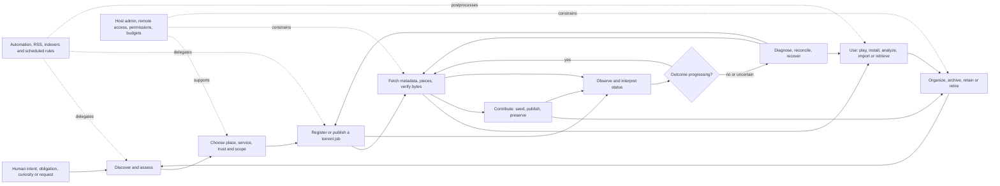
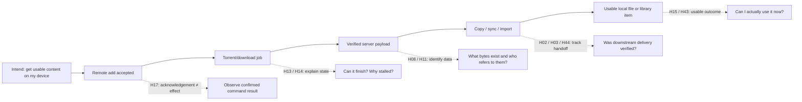

# Human-centered BitTorrent conceptual map: relationships and unexplored feature space

**Research snapshot:** 2026-10-29. **Status:** external descriptive research, **not normative requirements**. **Purpose:** explore conceptual sparsity and plausible missing capabilities in the *union* of the 240 existing feature concepts already compiled, by examining the functional, cognitive and possible emotional relationships among the human activities those features support.

**Inputs:** [External 240-feature inventory](https://github.com/gamesbyian/Chunks/blob/26fec615e8241504011f319929c40d22cc35bd9f/docs/BITTORRENT-ECOSYSTEM-FEATURE-INVENTORY-2026-10-29.md) and [36-journey / 240-micro-workflow atlas](https://github.com/gamesbyian/Chunks/blob/7631199f79b6763a961da5a2a3665886eb6964d7/docs/BITTORRENT-USER-GOALS-AND-WORKFLOWS-2026-10-29.md). The machine-readable, inspectable counterpart is [the typed JSON graph](BITTORRENT-CONCEPT-GRAPH-2026-10-29.json).

**Important epistemic boundary:** “Missing” here means **not explicitly represented as a complete capability in the 240-item inventory**, or **a relationship between existing capabilities is not covered there**. It emphatically does *not* mean no BitTorrent software anywhere implements it. Components, plugins, new releases and external services may already provide parts or even all of a candidate. All 54 H-series entries are hypotheses to investigate, not verified unmet market needs, commitments or requests to change a product.

## 1. Two views of the map

### 1.1 The human lifecycle and its non-linear routes



**How to read it:** The route is deliberately *not a mandatory linear funnel*. A publisher can start with an original file and go directly to creation and seeding. A cross-seeder can reuse already verified bytes. A mobile remote controls a separate engine; closing it does not stop the engine. An automation can start at a feed without a person opening a torrent client. A user's desired exit can happen before or well after the swarm completes.

### 1.2 Where a handoff stops being a comprehensible outcome



Existing tools have many of the boxes on the main line, and some tools bridge several. The H labels mark **places to test for a missing connective experience**, not blank boxes assumed absent from all software.

## 2. What exists in the conceptual evidence graph

| Layer | Nodes | Meaning |
|---|---:|---|
| Existing feature concepts | 240 | Individual capabilities from the external product inventory |
| Micro-activities | 240 | Reusable user tasks, each with trigger, sequence, recurrence and feature links |
| Macro journeys | 36 | Human-scale examples showing activities used together |
| Activity domains | 20 | Navigation groupings for tasks |
| Feature families | 15 | Navigation groupings for capabilities |
| Human goals | 18 | Desired outcomes independent of software mechanism |
| Cognitive demands | 16 | The mental work a user might be doing or trying to avoid |
| Possible affective stakes | 17 | Anticipation, uncertainty, trust, loss concern, pride and other context-sensitive possibilities |
| Gap domains | 9 | Qualitatively identified thin or discontinuous relationship zones |
| Candidate feature hypotheses | 54 | Potential unrepresented connective capabilities |
| **Total** | **665** | Typed nodes available for query, visualization and revision |

The JSON contains **3190 typed edges**, including 695 prior activity→feature links, 547 *co-support* relationships between feature concepts, 149 journey→activity memberships, 113 potential activity transitions and explicit relationships from the H hypotheses to the activities/features/cognitive demands/affective stakes they could affect.

**Caution about interpretation:** Co-support means that two features were linked to the *same described activity*. It proves neither that the features implement one another nor that they must both be present. The cognitive/affective mappings are analyst-supplied hypotheses, not interviews or psychological measurements. The graph retains the relationship type and evidence/interpretation level so those distinctions can be preserved.

## 3. Sparsity audit: what is thin, and what that does and does not prove

### 3.1 Measurable sparsity in the earlier feature/activity subgraph

The original unaugmented graph has **480 nodes** (240 features plus 240 activities) with **695 links**. It has **four disconnected components**:

| Component | Nodes | What's in it | Interpretation |
|---|---:|---|---|
| Main | 467 | Most transfer, file, remote, diagnostics, organization and maintenance activity | Broadly joined by shared tasks |
| Small island 1 | 5 | Casting/transcoding: A12.03, F09.04, F09.05, F15.10, A12.09 | The links from playback device context back to retrieval/readiness are thin in the original atlas |
| Small island 2 | 4 | Decentralized discovery/social channels: A01.09, F06.12, F15.04, A19.04 | The links between discovery, authenticity judgment, sharing and intake are under-described |
| Small island 3 | 4 | Indexer synchronization and provider health: A11.04, F06.06, F06.07, F06.09 | The links from source management to actual auto-intake/rejection and repair are under-described |

A further **54 of 240 feature concepts** have only **one** direct activity link; **120** have **one or two**. These are *degrees of the manually curated earlier crosswalk*, not observations about product usefulness or objective feature scarcity. Some are intrinsically specialist operations, and some are thin simply because one micro-activity was chosen to represent them.

The larger graph connects these islands through shared human goals, possible cognitive demands, possible affective stakes, macro journeys and H-series hypotheses. This is a conceptual assertion that related work belongs in an overlapping human context, **not evidence that an underlying software feature is absent**.

### 3.2 Sparsity that matters more than the raw graph count

A meaningful thin spot usually has a **human activity on either side**, with no explicit capability that closes the transition or verifies its outcome. It may take these forms:

| Thinness type | Tell-tale relationship | Representative hypotheses |
|---|---|---|
| **Handoff** | Two tools each report success, but nobody reports the final outcome | H02, H03, H44 |
| **Identity/reference** | A visible torrent is mistaken for data or for a media-library item | H08, H10, H11 |
| **Cognitive translation** | Technical state exists but does not answer the user's natural question | H13, H15, H49 |
| **Uncertain command** | Action accepted or connection lost before the effect is read back | H17, H35 |
| **Reversibility / safety** | A seemingly simple action has wider persistent consequences | H19, H20, H21 |
| **Temporal continuity** | Operations run for hours or weeks but a person's intent is forgotten | H25, H27, H30 |
| **Social verification** | A sharing action finishes but recipients cannot yet receive the content | H37, H38 |
| **Scope/authority** | Correct action, wrong engine, credentials or environment | H31, H33, H34 |
| **Use-readiness** | Torrent finished, but desired playback/research/import goal is not fulfilled | H43, H44, H46 |

These are **coverage hypotheses about complete human outcomes**. A product can support every underlying API operation and still leave a multi-step gap in the user's journey. Conversely, combining existing features may resolve a gap without introducing any new protocol primitive.

## 4. Functional, cognitive and affective relationships

The following map links *what someone is trying to do*, *what they must think about*, and *what may be at stake emotionally*. The last column is a possible direction of experience if the gap were addressed; it is not an asserted user emotion, target for persuasion, or measured outcome.

| Functional seam | Cognitive demand | Possible affective stake | Possible change in experience |
|---|---|---|---|
| Remote add → file on another device | Distinguish the controller from executing/storage host | Uncertainty about location; disappointment when file is missing locally | Knowing where it is, what remains and how to obtain it |
| Add → metadata → rare-piece downloading | Interpret incomplete/stale swarm evidence | Anticipation, frustration, false hope | Informed confidence or a clear negative assessment |
| Completion → media playback | Distinguish bytes/percent from codec, buffer and library readiness | Impatience, satisfaction or disappointment | A meaningful “ready for my use” signal |
| Job ↔ payload ↔ hardlink ↔ library | Track identity across names and filesystem references | Loss concern, confusion, concern about quota | Verifiable awareness of dependencies |
| Bulk file mutation → altered session | Mentally simulate consequences and unwind them | Anticipated regret or loss anxiety | Preflight knowledge and a practical recovery boundary |
| Timed rules → unattended work → return | Remember original purpose and distinguish silence from failure | Attention fatigue, lack of closure | Concise exceptions and resumable human intent |
| Seed/ratio → community availability | Understand tracker accounting and other participants' needs | Obligation pressure; satisfaction in helping others | Credible evidence of contribution and policy compliance |
| Seedbox RPC → service roles and ports | Distinguish authenticated interface, target tenant and permissions | Trust and privacy concern | Confidence about exact authority and host identity |
| Publish link → recipient success | Model the recipient's ability to retrieve bytes | Creative pride; uncertainty about reachability | Verifiable distribution rather than merely a posted magnet |

**Interpretation rule:** An emotion is a possible *stake in a task*, not a demographic label or stable property of a person. A user may enjoy a technical challenge that frustrates another. Some users enjoy manual curation; others value entirely unattended work. Emotional concepts should be treated as testable perspectives, not a deterministic UI-personality model.

## 5. Nine regions of potential conceptual whitespace

The nine regions below separate broad kinds of relationship gap. They are *not* ranked by importance, implementation cost or market demand.

### B01 · Goal-to-outcome continuity

**Thin relationship:** Users plan an outcome, while each tool reports success for only its own subtask. **Example:** A remote-add succeeded, but the file is still on the seedbox.

**Possible missing connective ability:** Maintaining intended result across distinct apps; confidence that work actually completed. **Human dimension:** Functional bridge; cognitive integration; uncertainty about completion.

**Candidate nodes:** H01, H02, H03, H04, H05, H06.

### B02 · Identity, provenance and references

**Thin relationship:** Jobs, metafiles, storage paths, hardlinks and library items refer to overlapping but nonidentical objects. **Example:** One filename change breaks a seed; removing a job reclaims no bytes.

**Possible missing connective ability:** Clear object boundaries and verified dependency/space accounting. **Human dimension:** Causal model of identity; concern about loss.

**Candidate nodes:** H07, H08, H09, H10, H11, H12.

### B03 · Observability and explanation

**Thin relationship:** Raw values convey protocol state but can fail to answer the user's actual question. **Example:** A torrent has many listed seeders but no retrievable rare piece.

**Possible missing connective ability:** Prediction of usable outcome and intelligible causes. **Human dimension:** Uncertainty and frustration; explanation/calibration.

**Candidate nodes:** H13, H14, H15, H16, H17, H18.

### B04 · Safe mutation and restoration

**Thin relationship:** Delete, move and automate actions cross object boundaries while undo may stop at one app. **Example:** A bulk settings misclick launches an unwanted move or rule.

**Possible missing connective ability:** Previewed effects, partial-failure recovery and explicit reversibility. **Human dimension:** Anticipated regret, safety, control.

**Candidate nodes:** H19, H20, H21, H22, H23, H24.

### B05 · Time, attention and intention

**Thin relationship:** Transfers, seeding, copies and library indexing run on different clocks. **Example:** Someone leaves for work while several future-facing actions remain unfinished.

**Possible missing connective ability:** Meaningful deadlines, resumable intent and low-noise attention. **Human dimension:** Anticipation, attention fatigue and closure.

**Candidate nodes:** H25, H26, H27, H28, H29, H30.

### B06 · Remote authority and security

**Thin relationship:** A remote controller can observe or affect something elsewhere, with different roles and transport assumptions. **Example:** A phone connects to the wrong numbered instance or retries an uncertain command.

**Possible missing connective ability:** Proven target and scope, secure/reconciled effects. **Human dimension:** Trust boundary tracking; privacy and loss concern.

**Candidate nodes:** H31, H32, H33, H34, H35, H36.

### B07 · Sharing and community stewardship

**Thin relationship:** Torrent creation, initial seeding, dissemination and recipient success are separate events. **Example:** Publisher shares magnet but cannot establish that recipients can fetch the bytes.

**Possible missing connective ability:** Verify availability, distribution and chosen sharing obligation. **Human dimension:** Other-person perspective, pride, uncertainty.

**Candidate nodes:** H37, H38, H39, H40, H41, H42.

### B08 · Media, creative and research consumption

**Thin relationship:** Bytes become useful only when the specific human use case has succeeded. **Example:** A completed download still needs SFTP, extraction, codec support or reproducible dataset provenance.

**Possible missing connective ability:** Delivery and readiness for desired use beyond torrent progress. **Human dimension:** Expectation, satisfaction, disappointed handoff.

**Candidate nodes:** H43, H44, H45, H46, H47, H48.

### B09 · Cognitive accessibility and confidence

**Thin relationship:** Advanced technology is described by mechanisms while people think in outcomes and consequences. **Example:** User asks if 'seeding' means they are actively uploading or if a setting will move files.

**Possible missing connective ability:** Explainable, scope-aware actions and sustained task context. **Human dimension:** Reduced confusion/overload; greater sense of control.

**Candidate nodes:** H49, H50, H51, H52, H53, H54.

## 6. Candidate missing-capability catalogue

These are deliberately phrased as **capability hypotheses**, not instructions to build them. Every row identifies what appears missing from the *description of the 240-feature union*, which activities would be helped, and which existing features border the apparent gap. `H` numbers are stable research identifiers in the graph data. The cognitive and possible affective relationships are also available as typed graph edges.

| ID | Candidate capability | What connective relationship is not explicit in the 240 features? | Activity examples | Adjacent existing features |
|---|---|---|---|---|
| **H01** | Goal-to-operation route planner | No single capability describes how a desired result decomposes across download, retrieval and use. | A01.12, A02.01, A08.04 | F01.02, F10.11 |
| **H02** | Cross-tool completion tracker | Torrent completion does not establish remote retrieval, import or playback completion. | A08.04, A10.01, A12.02 | F10.11, F09.12 |
| **H03** | Resumable file-delivery handoff | Copying remote payloads is a separate process with distinct progress and failure state. | A10.08, A08.07, A10.09 | F03.23, F11.14 |
| **H04** | Locate usable content across devices | A completed job can leave the user asking which machine actually holds usable bytes. | A10.01, A12.02, A08.06 | F07.07, F03.24 |
| **H05** | Path identity translation advisor | Filesystem mounts, containers, RPC paths and library paths refer to different address spaces. | A10.12, A08.10, A12.12 | F03.24, F10.07 |
| **H06** | Interruption-resilient workflow checkpoint | App switches or provider outages may erase awareness of what was done and what remains. | A08.07, A07.05, A20.01 | F10.10, F02.11 |
| **H07** | Content identity across different torrent descriptors | Equivalent files may be spread across hashes, release names, seed jobs and shared storage. | A16.07, A05.10, A07.09 | F06.11, F03.20 |
| **H08** | Job-to-byte-to-library dependency graph | Users lack an explicit, verified view of which jobs, files and library entries depend on each other. | A12.12, A17.02, A20.09 | F03.20, F03.24 |
| **H09** | Rename and move reconciliation ledger | File renames, display aliases and remote paths may diverge without an explanatory record. | A10.03, A16.01, A16.11 | F03.06, F03.19 |
| **H10** | Portable per-job migration manifest | A backup may omit divergent per-torrent paths or settings even when it restores job registration. | A16.09, A08.12, A16.05 | F02.17, F10.13 |
| **H11** | Real disk-block savings estimator | Deleting a hardlink or job may reclaim no blocks; displayed 'size' can mislead. | A17.02, A20.05, A17.01 | F03.20, F03.18 |
| **H12** | Object-level consequences of renaming | Users may confuse harmless aliases with changes that affect tracker-backed bytes or library access. | A07.03, A10.03, A12.06 | F03.05, F03.06 |
| **H13** | Cause-ranked stalled-transfer explanation | Status and raw tracker errors need interpretation before a rational next action is obvious. | A15.02, A06.01, A15.05 | F08.05, F08.07 |
| **H14** | Pre-add availability confidence with uncertainty | Seed counts and tracker claims alone do not establish that required pieces can be retrieved. | A01.08, A06.07, A15.02 | F08.11, F04.14 |
| **H15** | Wanted-file usability readiness | 100% of wanted bytes, complete torrent and actually playable file are different states. | A03.08, A12.01, A03.04 | F08.04, F09.01 |
| **H16** | End-to-end ready-by estimate | Torrent ETA omits copying, extraction, imports and scans needed for the true goal. | A04.01, A10.08, A12.02 | F08.03, F09.12 |
| **H17** | Requested-versus-verified action receipt | Remote request success, backend acknowledgement and observed effect are separate events. | A08.07, A15.12, A14.11 | F13.13, F10.09 |
| **H18** | Cross-app what-changed explanation | Activity histories are fractured by app boundaries and obscure why content moved or disappeared. | A04.10, A14.12, A11.09 | F02.11, F08.13 |
| **H19** | Cross-object mutation preview | Bulk actions can affect shared files, paths and automations outside the selected torrent rows. | A04.08, A14.11, A17.01 | F13.11, F02.04 |
| **H20** | Dependency-safe deletion decision aid | A cleanup command needs to know whether another seed or media library still relies on a path. | A20.05, A17.02, A12.12 | F03.19, F12.09 |
| **H21** | Recovery window and reversible quarantine | Simple delete/trash settings do not inherently offer an end-to-end undo across torrent and file layers. | A20.05, A16.12, A20.09 | F03.22, F02.18 |
| **H22** | Guided missing-file reconciliation | A torrent with valid bytes under a new path still requires locating and remapping them correctly. | A16.01, A16.02, A16.11 | F03.19, F03.15 |
| **H23** | Restoration rehearsal and dependency proof | Backups may exist without evidence that jobs, paths, credentials and imports can be restored together. | A16.09, A16.10, A20.07 | F02.17, F11.12 |
| **H24** | Compensating actions for partial automation | An automation chain can succeed at one step and fail after moving or renaming data. | A11.07, A11.11, A15.12 | F12.03, F13.14 |
| **H25** | Time-to-use forecast under swarm scarcity | Transfer speed projections rarely communicate rare-piece uncertainty or deadline risk. | A06.07, A04.01, A12.01 | F08.03, F04.14 |
| **H26** | Budget-aware scheduling with consequences | A user wants to meet a cap or deadline rather than manage unrelated rate and calendar settings. | A17.03, A17.07, A17.08 | F05.07, F11.11 |
| **H27** | Resume the human task, not merely the job | History retains transfers but not always the decision or unfinished operation that brought the person in. | A07.05, A20.01, A04.10 | F07.10, F02.11 |
| **H28** | Attention-budgeted exception digest | High-volume services benefit from a ranked summary of actionable issues instead of raw notifications. | A04.10, A11.11, A05.07 | F12.06, F08.13 |
| **H29** | Temporary intent-based policy with auto-reversal | A user may mean 'until this call ends' instead of a manually remembered bandwidth toggle. | A17.04, A17.05, A08.06 | F05.02, F05.13 |
| **H30** | Multi-stage retention intent plan | Completion, ratio, archive, preservation and retirement may follow different clocks. | A05.09, A20.03, A20.11 | F05.06, F02.14 |
| **H31** | Verified remote endpoint setup and capabilities | Provider hints and a successful login may not prove that intended RPC features work on the selected engine. | A08.01, A18.11, A08.03 | F14.13, F10.06 |
| **H32** | Evidence-backed privacy route test | VPN binding or proxy configuration alone cannot prove all traffic follows the intended route. | A14.01, A14.02, A15.03 | F13.03, F08.07 |
| **H33** | Destructive-target server identity proof | Similar names and combined views increase the cost of acting on the wrong server. | A08.02, A14.11, A20.05 | F10.08, F13.11 |
| **H34** | Explicit remote authority boundary viewer | RPC torrent controls and server-side filesystem privileges are often separate credentials and scopes. | A08.10, A09.07, A14.07 | F10.07, F13.06 |
| **H35** | Safe recovery from uncertain remote commands | Automatic reconnection may mask uncertainty about whether a prior mutation actually happened. | A08.07, A15.01, A15.12 | F10.10, F13.13 |
| **H36** | Credential lifecycle and expiry foresight | A remote workflow can quietly fail when tracker credentials, sessions or certificates expire. | A09.05, A11.05, A14.04 | F13.07, F11.03 |
| **H37** | Publisher-side reachability test | Creating torrent metadata and starting a seeder does not prove a recipient can retrieve content. | A13.01, A13.10, A13.12 | F01.12, F08.07 |
| **H38** | Recipient delivery status with consent | One-way link sharing leaves the sender unsure whether others received complete data. | A13.01, A13.12, A19.01 | F15.01, F08.03 |
| **H39** | Rare-piece scarcity and alternative-source assistant | Nearly complete swarms can be missing the same rare piece while nominal seed counts look promising. | A06.07, A15.02, A01.08 | F04.14, F06.11 |
| **H40** | Contribution visibility beyond uploaded bytes | Share ratio doesn't fully reflect long-term rare-content availability or community value. | A05.04, A05.06, A05.09 | F08.11, F05.06 |
| **H41** | Cross-tracker obligation summary | A multi-tracker seeder has separate eligibility and time/ratio conditions that can be hard to reconcile. | A05.02, A05.03, A05.10 | F04.19, F05.06 |
| **H42** | Content authenticity and provenance chain | A publisher's identity, file signature and metainfo are often separate facts to evaluate. | A01.07, A13.08, A01.10 | F03.13, F01.19 |
| **H43** | Playback-target-aware readiness | A file may be streamable locally yet unsuitable for a remote TV, codec or bandwidth context. | A12.03, A03.04, A12.09 | F09.01, F09.04 |
| **H44** | Verified remote-to-library delivery | A completed server torrent is not the same as a correctly named, indexed, playable local library entry. | A12.02, A10.01, A12.12 | F09.12, F03.24 |
| **H45** | Identity-preserving release-name cleanup | A human-readable media filename edit may break seeding, source attribution or another application's mapping. | A12.06, A10.03, A07.03 | F09.11, F03.06 |
| **H46** | Research dataset provenance and subset manifest | Selective research acquisition needs a reproducible record of data version, chosen files and verification. | A01.04, A03.06, A10.07 | F03.02, F03.13 |
| **H47** | Release-family publishing continuity | Publishing a new version changes discovery, seeding and recipient upgrade paths, not merely the torrent metadata. | A13.11, A13.10, A13.07 | F01.12, F07.08 |
| **H48** | Purpose-aware non-media postprocessing | Media-oriented import automation does not capture every desired use of archives, datasets, software or personal files. | A01.04, A10.04, A19.10 | F12.07, F07.09 |
| **H49** | In-context explanation of seeding and state | Raw terms such as seeded, connected, availability, ratio or metadata can be misread as outcomes. | A05.01, A03.01, A04.01 | F14.12, F08.03 |
| **H50** | What-will-happen simulation for a setting change | A scope-sensitive change may have effects far beyond the visible control, especially in bulk operations. | A14.11, A17.05, A04.08 | F05.13, F13.11 |
| **H51** | Layered intent-to-capability navigation | Casual and advanced users seek the same goal with very different technical vocabularies. | A01.12, A18.01, A18.07 | F14.09, F14.13 |
| **H52** | Automation reason and provenance explanation | A rule-triggered rename, delete or import can feel arbitrary when the matching evidence is hidden. | A11.09, A11.10, A14.12 | F12.13, F12.10 |
| **H53** | Restore task continuity after a failure | Diagnostics are often disconnected from where the user was trying to finish a task. | A15.12, A04.10, A16.10 | F08.08, F14.07 |
| **H54** | Contextual default from stated immediate purpose | People may intend 'use Wi-Fi, finish before travel, preserve seeding' rather than manually setting many scopes. | A17.07, A02.07, A20.11 | F05.07, F05.13 |

### 6.1 What “missing” should mean at different levels

1. **Missing from an inventory:** no explicit feature entry describes the *whole* hypothesized function, even though components may exist.
2. **Missing from a particular surface or engine:** the API, mobile remote, provider panel and desktop frontend expose different subsets. This needs product/version evidence, which this map deliberately does not assert.
3. **Existing but cognitively inaccessible:** a function exists, but the person cannot easily discover it, understand scope or verify the outcome.
4. **Missing causal link:** two features exist but the human handoff, verification or rollback is absent or scattered among tools.
5. **Truly novel:** the function has not been found in any product or combination after sufficiently wide research. **No H item is claimed to have reached this threshold.**

### 6.2 Real-world counterexamples and disconfirmation signals

The hypothesis list must be read against real product evolution. Several apparently empty areas are already receiving direct attention.

- [qBittorrent issue #15447](https://github.com/qbittorrent/qBittorrent/issues/15447) describes an accidental bulk automatic-management action and the absence of a convenient undo. It grounds the **consequence-preview** and **reversibility** concern, but is not evidence of a universal lack of undo.
- [qBittorrent issue #17142](https://github.com/qbittorrent/qBittorrent/issues/17142) requests protections against changes to active seeding data. It grounds the **job-to-file safety** connection, not a claim that filesystem permission protections never exist.
- [autobrr/qui issue #2061](https://github.com/autobrr/qui/issues/2061) documents why restoring categories without **per-torrent save paths** could break atypical cross-seed layouts. The issue was later closed, and [qui releases](https://github.com/autobrr/qui/releases) document continuing backup, automation and cleanup safeguards. Therefore H10 is a *specific research seam that may already have a solution*, not a claim about current qui behavior.
- A [user discussion of a swarm at 99.9% for months](https://www.reddit.com/r/qBittorrent/comments/1twxmkx/this_is_really_frustrating/) illustrates how seed counts and near-completion can generate misleading hopes. It supports investigation of H14, H25 and H39 but provides no basis for prevalence.
- A [seeding terminology discussion](https://www.reddit.com/r/torrents/comments/hpvcv4) shows how “seeding,” “uploading now” and “content is available” can be mentally conflated. It motivates H49's interpretive relationship.
- A [community feature wishlist](https://www.reddit.com/r/torrents/comments/tdqdyt) specifically calls for coordinating storage movement, integrity-preserving torrent management and multiple clients. It aligns with H02/H08 but does not show those capabilities are still unavailable in 2026.
- The [qBittorrent changelog](https://github.com/qbittorrent/qBittorrent/blob/master/Changelog) includes UI and API developments that may implement pieces of the hypotheses; as products evolve, a gap must be *rechecked*, not assumed permanent.

**Implication:** The strongest defensible output of this map is a set of **search targets** and conceptual relationships that the older feature inventory may have missed. It is not a verdict on the entire market.

## 7. The map's most consequential junctions

### 7.1 Registration, data and location

`Job registration`, `torrent metainfo`, `verified payload bytes`, `filesystem path`, `storage blocks`, and `library item` are different concepts. The previous inventory includes rename, move, hash verification, hardlink and remote file browser functionality. The missing *relationship to investigate* is a coherent representation of how these objects depend on one another across machines. This single seam helps explain what goes wrong with rename, migration, deletion, cross-seeding, media import, remote copy and quota cleanup. Refer to H05, H08–H12, H20, H22 and H44.

### 7.2 Requested action and actual effect

A remote client can say that a command was sent; the daemon can acknowledge it; a filesystem operation may still be running; the user may ultimately want a playable item. Those events form a causal chain, and failures between steps do not map neatly to a generic success/failure toast. This links remote-control UI, retry semantics, notifications, copy/sync, import and recovery. Refer to H02, H03, H17, H24, H35 and H44.

### 7.3 Time and human attention

Per-torrent speed and ETA are meaningful but insufficient for some human objectives. A user's goal may depend on a rare piece, several hours of seeding credit, a remote copy, a future deadline or a storage quota. Clock-time scheduling and ratio rules exist; predicting the **goal-level result** and helping a person reenter after an interruption are distinct possible capabilities. Refer to H15, H16, H25–H30, H49 and H54.

### 7.4 Cooperation and publishing

An available torrent file or magnet is metadata; a working swarm and an accessible initial seed are the distribution reality. For publishers and preservation-focused users, recipient experience and long-tail availability matter beyond basic up/down counters. Those are plausible missing relationships between creation, tracker announces, seeding, community trust and download readiness. Refer to H37–H42.

### 7.5 Security and control

A phone remote, an rTorrent XML-RPC endpoint, a web UI, an SSH login and a provider panel can each have distinct credentials and authority. The user needs to understand *where* and *under whose authority* an operation occurs and what is verified afterward. Connecting these layers conceptually avoids mistaking API support for an authorized filesystem mutation. Refer to H31–H36.

## 8. Graph model: how to read or extend the data

The JSON is **data**, not executable product code. Each node has a stable ID and a type; each edge has a `from`, `to`, `type`, and `confidence` flag. Many activity nodes also retain triggers, sequences and qualitative cadence. H nodes retain their hypothesis explanation. Typical queries:

```sh
# Which A activities are supported by feature F03.20?
jq -r '.edges[] | select(.type=="enabled_or_explained_by" and .to=="F03.20") | .from' BITTORRENT-CONCEPT-GRAPH-2026-10-29.json

# Which hypotheses connect to an activity?
jq -r '.edges[] | select(.type=="would_support_activity" and .to=="A16.01") | .from' BITTORRENT-CONCEPT-GRAPH-2026-10-29.json

# Which feature pairs are co-linked by at least two activities?
jq -r '.edges[] | select(.type=="co_supports_activity" and .weight>=2) | [.from,.to,.weight] | @tsv' BITTORRENT-CONCEPT-GRAPH-2026-10-29.json

# Which H nodes bridge existing features?
jq -r '.nodes[] | select(.type=="missing_capability_hypothesis") | [.id,.label,.missingLink] | @tsv' BITTORRENT-CONCEPT-GRAPH-2026-10-29.json
```

The graph stores `confidence` labels such as `document-derived`, `previous_atlas_synthesis`, `derived_co_occurrence`, `interpretive`, and `hypothesis`. They describe **how the edge was produced**, not numerical probabilities of correctness. Human goals and affective stakes are attached at the *activity domain* level, a deliberate low-resolution first pass. It should not be treated as psychographic data about actual users. The 54 H nodes have more specifically chosen activity, feature, cognition and affective links.

**Edge types to keep separate:**

- `enabled_or_explained_by`: an existing F feature may serve an activity; it might be engine-level rather than user-facing.
- `co_supports_activity`: two existing F features share one or more A activities; the weight is a co-link count, **not** interaction or demand frequency.
- `serves_goal`, `involves_cognitive_demand`, `may_involve_affective_stake`: interpretive explanation of an activity.
- `illustratively_contains`, `may_precede_in_example`: links in the 36 earlier macro journeys, **not mandatory dependencies**.
- `extends_or_bridges_existing`, `would_support_activity`: hypothetical H-to-F and H-to-A connections.
- `responds_to_possible_affect`, `could_support_affective_shift`: conditional emotional consequences, **not empirical effects**.

## 9. How to examine or falsify a proposed gap

A good gap analysis must actively search for disconfirming evidence:

1. **Verify representation:** Does the full 240-feature inventory already say exactly what H proposes? If yes, merge/cross-reference the concept and mark the H as *covered in the inventory*, not a new feature.
2. **Verify product/version reality:** Search active clients, remote frontends, plugins, provider tools, documentation and implementation. A feature may be hidden in an API, extension or integration.
3. **Verify interaction completeness:** Does the user actually reach the desired state across all relevant systems, or merely complete a subtask? Test a sequence, not a screenshot.
4. **Check cognitive assumptions:** Ask whether the user has to understand complex identity, time, authority or consequences to reach the goal; record any genuine confusion.
5. **Check affective assumptions:** Do not infer emotional prevalence from an adjective in one discussion. Interview or observe people with different goals, including those who enjoy manual control.
6. **Check conditional necessity:** Does this matter only for cross-seeding, private trackers, media managers, Android storage, remote hosts or low-availability swarms? Mark environments explicitly.
7. **Record result:** `already_compound`, `already_standalone`, `implementation_specific_gap`, `workflow_gap`, `unsupported_hypothesis`, or `not_yet_checked` are useful evidence labels. The current H series should all initially be considered `not_yet_checked` at market-wide scope.

**A sparsely linked feature is not necessarily underdeveloped; a densely linked feature is not necessarily useful.** The meaningful target is a gap between a person's intention, the interaction they can perform, the resulting state, and the confidence with which they can know that state has been reached.

## 10. Boundaries and handoff

The research remains external and exploratory. It introduces **no new requirements**, makes **no assessment of the existing product**, creates **no backlog or prioritized roadmap**, and does not modify the underlying 240-feature inventory or the 240-activity atlas. No user study or instrumented usage data was collected. Neither the numerical graph size nor the 54 hypotheses should be interpreted as population coverage or proven novelty.

**Artifacts:**

- This document: readable conceptual map, sparsity interpretation, diagrams, all H hypotheses and research validation method.
- [Typed graph data](BITTORRENT-CONCEPT-GRAPH-2026-10-29.json): full nodes, edges, IDs, alternative routes, cognitive and possible emotional relations, plus derived feature co-occurrence.
- [Feature inventory](https://github.com/gamesbyian/Chunks/blob/26fec615e8241504011f319929c40d22cc35bd9f/docs/BITTORRENT-ECOSYSTEM-FEATURE-INVENTORY-2026-10-29.md): source-of-record for observed product capabilities.
- [Activity atlas](https://github.com/gamesbyian/Chunks/blob/7631199f79b6763a961da5a2a3665886eb6964d7/docs/BITTORRENT-USER-GOALS-AND-WORKFLOWS-2026-10-29.md): source-of-record for illustrated user workflows.

To extend the map in future research, update the evidence and edge semantics before treating a weakly supported candidate as a truly missing capability. The graph is intentionally designed to help challenge its own assumptions.
