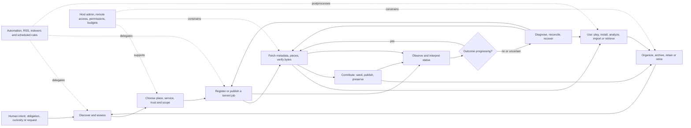
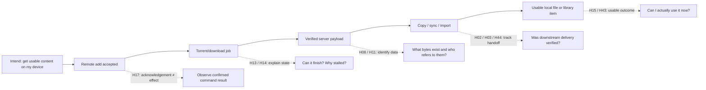
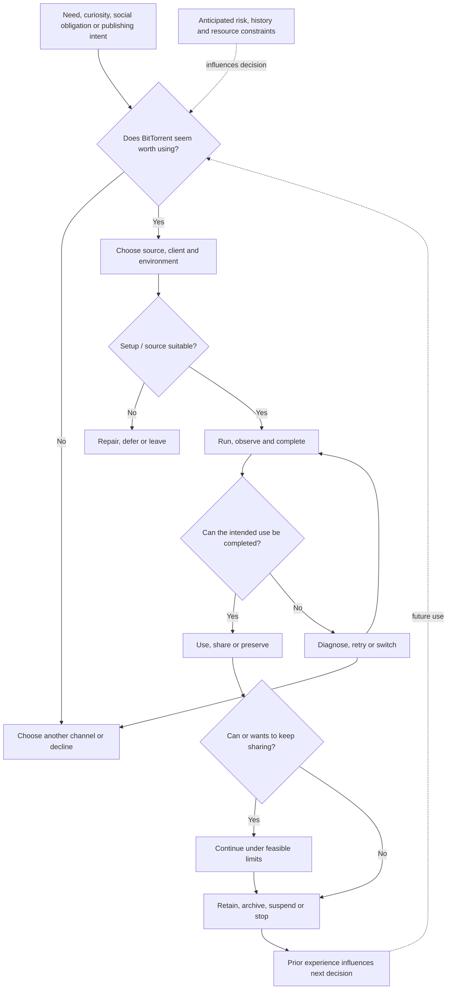

# Human-centered BitTorrent conceptual map: relationships and unexplored feature space

**Research snapshot:** 2026-10-29 (aversion-evidence bridge added same date). **Status:** external descriptive research, **not normative requirements**. **Purpose:** explore conceptual sparsity and plausible missing capabilities in the *union* of the 240 existing feature concepts already compiled, by examining the functional, cognitive and possible emotional relationships among the human activities those features support.

**Inputs:** [Multilingual aversion and abandonment research](https://github.com/gamesbyian/Chunks/blob/e5f89506c50ff64e8e96a3c080dbd7a218e2b11f/docs/BITTORRENT-USER-AVERSION-RESEARCH-2026-10-29.md), [External 240-feature inventory](https://github.com/gamesbyian/Chunks/blob/26fec615e8241504011f319929c40d22cc35bd9f/docs/BITTORRENT-ECOSYSTEM-FEATURE-INVENTORY-2026-10-29.md) and [36-journey / 240-micro-workflow atlas](https://github.com/gamesbyian/Chunks/blob/7631199f79b6763a961da5a2a3665886eb6964d7/docs/BITTORRENT-USER-GOALS-AND-WORKFLOWS-2026-10-29.md). The machine-readable, inspectable counterpart is [the typed JSON graph](BITTORRENT-CONCEPT-GRAPH-2026-10-29.json).

**Important epistemic boundary:** “Missing” here means **not explicitly represented as a complete capability in the 240-item inventory**, or **a relationship between existing capabilities is not covered there**. It emphatically does *not* mean no BitTorrent software anywhere implements it. Components, plugins, new releases and external services may already provide parts or even all of a candidate. All 69 H-series entries are hypotheses to investigate, not verified unmet market needs, commitments or requests to change a product.

## 1. Two views of the map

### 1.1 The human lifecycle and its non-linear routes



**How to read it:** The route is deliberately *not a mandatory linear funnel*. A publisher can start with an original file and go directly to creation and seeding. A cross-seeder can reuse already verified bytes. A mobile remote controls a separate engine; closing it does not stop the engine. An automation can start at a feed without a person opening a torrent client. A user's desired exit can happen before or well after the swarm completes.

### 1.2 Where a handoff stops being a comprehensible outcome



Existing tools have many of the boxes on the main line, and some tools bridge several. The H labels mark **places to test for a missing connective experience**, not blank boxes assumed absent from all software.

## 2. What exists in the conceptual evidence graph

| Layer | Nodes | Meaning |
|---|---:|---|
| Existing feature concepts | 240 | Individual capabilities from the external product inventory |
| Micro-activities | 240 | Reusable user tasks, each with trigger, sequence, recurrence and feature links |
| Macro journeys | 36 | Human-scale examples showing activities used together |
| Activity domains | 20 | Navigation groupings for tasks |
| Feature families | 15 | Navigation groupings for capabilities |
| Human goals | 23 | Desired outcomes independent of software mechanism |
| Cognitive demands | 21 | The mental work a user might be doing or trying to avoid |
| Possible affective stakes | 21 | Anticipation, uncertainty, trust, loss concern, pride and other context-sensitive possibilities |
| Gap domains | 11 | Qualitatively identified thin or discontinuous relationship zones |
| Candidate feature hypotheses | 69 | Potential unrepresented connective capabilities |
| Reported aversion factors | 55 | First-person complaints, distinctive cases and contingent perceptions from PR #539 |
| Friction domains | 6 | Why people avoid, quit or reluctantly participate |
| Possible exit or alternate paths | 21 | Conditional non-use, interruption, repair abandonment or switching routes |
| Additional evidence sources | 10 | Historical academic findings, individual user accounts and primary software guidance |
| Individual aversion source records | 57 | Original links from PR #539; some share the same underlying discussion |
| Implementation and context evidence records | 25 | Documented client capabilities, OS rules, task-level accessibility reports and cross-domain studies |
| Discontinuance theory categories | 7 | Cross-domain analytical taxonomy of different reasons for stopping |
| **Total** | **877** | Typed nodes available for query, visualization and revision |

The JSON contains **3,832 typed edges**, including 695 prior activity→feature links, 547 *co-support* relationships between feature concepts, 149 journey→activity memberships, 113 potential activity transitions and explicit relationships from the H hypotheses to the activities/features/cognitive demands/affective stakes they could affect.

**Caution about interpretation:** Co-support means that two features were linked to the *same described activity*. It proves neither that the features implement one another nor that they must both be present. The cognitive/affective mappings are analyst-supplied hypotheses, not interviews or psychological measurements. The graph retains the relationship type and evidence/interpretation level so those distinctions can be preserved.

## 3. Sparsity audit: what is thin, and what that does and does not prove

### 3.1 Measurable sparsity in the earlier feature/activity subgraph

The original unaugmented graph has **480 nodes** (240 features plus 240 activities) with **695 links**. It has **four disconnected components**:

| Component | Nodes | What's in it | Interpretation |
|---|---:|---|---|
| Main | 467 | Most transfer, file, remote, diagnostics, organization and maintenance activity | Broadly joined by shared tasks |
| Small island 1 | 5 | Casting/transcoding: A12.03, F09.04, F09.05, F15.10, A12.09 | The links from playback device context back to retrieval/readiness are thin in the original atlas |
| Small island 2 | 4 | Decentralized discovery/social channels: A01.09, F06.12, F15.04, A19.04 | The links between discovery, authenticity judgment, sharing and intake are under-described |
| Small island 3 | 4 | Indexer synchronization and provider health: A11.04, F06.06, F06.07, F06.09 | The links from source management to actual auto-intake/rejection and repair are under-described |

A further **54 of 240 feature concepts** have only **one** direct activity link; **120** have **one or two**. These are *degrees of the manually curated earlier crosswalk*, not observations about product usefulness or objective feature scarcity. Some are intrinsically specialist operations, and some are thin simply because one micro-activity was chosen to represent them.

The larger graph connects these islands through shared human goals, possible cognitive demands, possible affective stakes, macro journeys and H-series hypotheses. This is a conceptual assertion that related work belongs in an overlapping human context, **not evidence that an underlying software feature is absent**.

### 3.2 Sparsity that matters more than the raw graph count

A meaningful thin spot usually has a **human activity on either side**, with no explicit capability that closes the transition or verifies its outcome. It may take these forms:

| Thinness type | Tell-tale relationship | Representative hypotheses |
|---|---|---|
| **Handoff** | Two tools each report success, but nobody reports the final outcome | H02, H03, H44 |
| **Identity/reference** | A visible torrent is mistaken for data or for a media-library item | H08, H10, H11 |
| **Cognitive translation** | Technical state exists but does not answer the user's natural question | H13, H15, H49 |
| **Uncertain command** | Action accepted or connection lost before the effect is read back | H17, H35 |
| **Reversibility / safety** | A seemingly simple action has wider persistent consequences | H19, H20, H21 |
| **Temporal continuity** | Operations run for hours or weeks but a person's intent is forgotten | H25, H27, H30 |
| **Social verification** | A sharing action finishes but recipients cannot yet receive the content | H37, H38 |
| **Scope/authority** | Correct action, wrong engine, credentials or environment | H31, H33, H34 |
| **Use-readiness** | Torrent finished, but desired playback/research/import goal is not fulfilled | H43, H44, H46 |

These are **coverage hypotheses about complete human outcomes**. A product can support every underlying API operation and still leave a multi-step gap in the user's journey. Conversely, combining existing features may resolve a gap without introducing any new protocol primitive.

## 4. Functional, cognitive and affective relationships

The following map links *what someone is trying to do*, *what they must think about*, and *what may be at stake emotionally*. The last column is a possible direction of experience if the gap were addressed; it is not an asserted user emotion, target for persuasion, or measured outcome.

| Functional seam | Cognitive demand | Possible affective stake | Possible change in experience |
|---|---|---|---|
| Remote add → file on another device | Distinguish the controller from executing/storage host | Uncertainty about location; disappointment when file is missing locally | Knowing where it is, what remains and how to obtain it |
| Add → metadata → rare-piece downloading | Interpret incomplete/stale swarm evidence | Anticipation, frustration, false hope | Informed confidence or a clear negative assessment |
| Completion → media playback | Distinguish bytes/percent from codec, buffer and library readiness | Impatience, satisfaction or disappointment | A meaningful “ready for my use” signal |
| Job ↔ payload ↔ hardlink ↔ library | Track identity across names and filesystem references | Loss concern, confusion, concern about quota | Verifiable awareness of dependencies |
| Bulk file mutation → altered session | Mentally simulate consequences and unwind them | Anticipated regret or loss anxiety | Preflight knowledge and a practical recovery boundary |
| Timed rules → unattended work → return | Remember original purpose and distinguish silence from failure | Attention fatigue, lack of closure | Concise exceptions and resumable human intent |
| Seed/ratio → community availability | Understand tracker accounting and other participants' needs | Obligation pressure; satisfaction in helping others | Credible evidence of contribution and policy compliance |
| Seedbox RPC → service roles and ports | Distinguish authenticated interface, target tenant and permissions | Trust and privacy concern | Confidence about exact authority and host identity |
| Publish link → recipient success | Model the recipient's ability to retrieve bytes | Creative pride; uncertainty about reachability | Verifiable distribution rather than merely a posted magnet |

**Interpretation rule:** An emotion is a possible *stake in a task*, not a demographic label or stable property of a person. A user may enjoy a technical challenge that frustrates another. Some users enjoy manual curation; others value entirely unattended work. Emotional concepts should be treated as testable perspectives, not a deterministic UI-personality model.

## 5. Eleven regions of potential conceptual whitespace

The eleven regions below separate broad kinds of relationship gap. They are *not* ranked by importance, implementation cost or market demand.

### B01 · Goal-to-outcome continuity

**Thin relationship:** Users plan an outcome, while each tool reports success for only its own subtask. **Example:** A remote-add succeeded, but the file is still on the seedbox.

**Possible missing connective ability:** Maintaining intended result across distinct apps; confidence that work actually completed. **Human dimension:** Functional bridge; cognitive integration; uncertainty about completion.

**Candidate nodes:** H01, H02, H03, H04, H05, H06.

### B02 · Identity, provenance and references

**Thin relationship:** Jobs, metafiles, storage paths, hardlinks and library items refer to overlapping but nonidentical objects. **Example:** One filename change breaks a seed; removing a job reclaims no bytes.

**Possible missing connective ability:** Clear object boundaries and verified dependency/space accounting. **Human dimension:** Causal model of identity; concern about loss.

**Candidate nodes:** H07, H08, H09, H10, H11, H12.

### B03 · Observability and explanation

**Thin relationship:** Raw values convey protocol state but can fail to answer the user's actual question. **Example:** A torrent has many listed seeders but no retrievable rare piece.

**Possible missing connective ability:** Prediction of usable outcome and intelligible causes. **Human dimension:** Uncertainty and frustration; explanation/calibration.

**Candidate nodes:** H13, H14, H15, H16, H17, H18.

### B04 · Safe mutation and restoration

**Thin relationship:** Delete, move and automate actions cross object boundaries while undo may stop at one app. **Example:** A bulk settings misclick launches an unwanted move or rule.

**Possible missing connective ability:** Previewed effects, partial-failure recovery and explicit reversibility. **Human dimension:** Anticipated regret, safety, control.

**Candidate nodes:** H19, H20, H21, H22, H23, H24.

### B05 · Time, attention and intention

**Thin relationship:** Transfers, seeding, copies and library indexing run on different clocks. **Example:** Someone leaves for work while several future-facing actions remain unfinished.

**Possible missing connective ability:** Meaningful deadlines, resumable intent and low-noise attention. **Human dimension:** Anticipation, attention fatigue and closure.

**Candidate nodes:** H25, H26, H27, H28, H29, H30.

### B06 · Remote authority and security

**Thin relationship:** A remote controller can observe or affect something elsewhere, with different roles and transport assumptions. **Example:** A phone connects to the wrong numbered instance or retries an uncertain command.

**Possible missing connective ability:** Proven target and scope, secure/reconciled effects. **Human dimension:** Trust boundary tracking; privacy and loss concern.

**Candidate nodes:** H31, H32, H33, H34, H35, H36.

### B07 · Sharing and community stewardship

**Thin relationship:** Torrent creation, initial seeding, dissemination and recipient success are separate events. **Example:** Publisher shares magnet but cannot establish that recipients can fetch the bytes.

**Possible missing connective ability:** Verify availability, distribution and chosen sharing obligation. **Human dimension:** Other-person perspective, pride, uncertainty.

**Candidate nodes:** H37, H38, H39, H40, H41, H42.

### B08 · Media, creative and research consumption

**Thin relationship:** Bytes become useful only when the specific human use case has succeeded. **Example:** A completed download still needs SFTP, extraction, codec support or reproducible dataset provenance.

**Possible missing connective ability:** Delivery and readiness for desired use beyond torrent progress. **Human dimension:** Expectation, satisfaction, disappointed handoff.

**Candidate nodes:** H43, H44, H45, H46, H47, H48.

### B09 · Cognitive accessibility and confidence

**Thin relationship:** Advanced technology is described by mechanisms while people think in outcomes and consequences. **Example:** User asks if 'seeding' means they are actively uploading or if a setting will move files.

**Possible missing connective ability:** Explainable, scope-aware actions and sustained task context. **Human dimension:** Reduced confusion/overload; greater sense of control.

**Candidate nodes:** H49, H50, H51, H52, H53, H54.

### B10 · Before adoption: deciding not to use BitTorrent

**Thin relationship:** The original map starts with intent *inside* a BitTorrent journey, but someone may compare price, source trust, privacy, ethics, effort and other acquisition routes **before** ever installing a client.

**Candidate nodes:** H55, H56, H60–H64 and H66. **Possible exits:** N01–N04, N11–N14, N16–N17.

**Distinction:** Some factors are under software control (explanation, metadata visibility, better backup/export), others are external (law, participant choice, source authenticity, tracker access). A legitimate outcome may be choosing a completely different channel or declining to acquire the content.

### B11 · Participation: willingness to share versus ability to do so

**Thin relationship:** A user can sincerely want to seed, yet be constrained by asymmetric uplink, household contention, metered data, battery, electricity, disk, poor peer demand or private tracker credit schemes.

**Candidate nodes:** H57–H59 and H65. **Possible exits:** N06–N08, N10, N15–N16.

**Distinction:** Contribution has multiple measures: uptime, availability to rare swarms, bytes uploaded and policy credit. They are not equivalent. Neither a client nor a user's effort can manufacture upload demand or guarantee acceptance into a private community.

## 6. Candidate missing-capability catalogue

These are deliberately phrased as **capability hypotheses**, not instructions to build them. Every row identifies what appears missing from the *description of the 240-feature union*, which activities would be helped, and which existing features border the apparent gap. `H` numbers are stable research identifiers in the graph data. The cognitive and possible affective relationships are also available as typed graph edges.

| ID | Candidate capability | What connective relationship is not explicit in the 240 features? | Activity examples | Adjacent existing features |
|---|---|---|---|---|
| **H01** | Goal-to-operation route planner | No single capability describes how a desired result decomposes across download, retrieval and use. | A01.12, A02.01, A08.04 | F01.02, F10.11 |
| **H02** | Cross-tool completion tracker | Torrent completion does not establish remote retrieval, import or playback completion. | A08.04, A10.01, A12.02 | F10.11, F09.12 |
| **H03** | Resumable file-delivery handoff | Copying remote payloads is a separate process with distinct progress and failure state. | A10.08, A08.07, A10.09 | F03.23, F11.14 |
| **H04** | Locate usable content across devices | A completed job can leave the user asking which machine actually holds usable bytes. | A10.01, A12.02, A08.06 | F07.07, F03.24 |
| **H05** | Path identity translation advisor | Filesystem mounts, containers, RPC paths and library paths refer to different address spaces. | A10.12, A08.10, A12.12 | F03.24, F10.07 |
| **H06** | Interruption-resilient workflow checkpoint | App switches or provider outages may erase awareness of what was done and what remains. | A08.07, A07.05, A20.01 | F10.10, F02.11 |
| **H07** | Content identity across different torrent descriptors | Equivalent files may be spread across hashes, release names, seed jobs and shared storage. | A16.07, A05.10, A07.09 | F06.11, F03.20 |
| **H08** | Job-to-byte-to-library dependency graph | Users lack an explicit, verified view of which jobs, files and library entries depend on each other. | A12.12, A17.02, A20.09 | F03.20, F03.24 |
| **H09** | Rename and move reconciliation ledger | File renames, display aliases and remote paths may diverge without an explanatory record. | A10.03, A16.01, A16.11 | F03.06, F03.19 |
| **H10** | Portable per-job migration manifest | A backup may omit divergent per-torrent paths or settings even when it restores job registration. | A16.09, A08.12, A16.05 | F02.17, F10.13 |
| **H11** | Real disk-block savings estimator | Deleting a hardlink or job may reclaim no blocks; displayed 'size' can mislead. | A17.02, A20.05, A17.01 | F03.20, F03.18 |
| **H12** | Object-level consequences of renaming | Users may confuse harmless aliases with changes that affect tracker-backed bytes or library access. | A07.03, A10.03, A12.06 | F03.05, F03.06 |
| **H13** | Cause-ranked stalled-transfer explanation | Status and raw tracker errors need interpretation before a rational next action is obvious. | A15.02, A06.01, A15.05 | F08.05, F08.07 |
| **H14** | Pre-add availability confidence with uncertainty | Seed counts and tracker claims alone do not establish that required pieces can be retrieved. | A01.08, A06.07, A15.02 | F08.11, F04.14 |
| **H15** | Wanted-file usability readiness | 100% of wanted bytes, complete torrent and actually playable file are different states. | A03.08, A12.01, A03.04 | F08.04, F09.01 |
| **H16** | End-to-end ready-by estimate | Torrent ETA omits copying, extraction, imports and scans needed for the true goal. | A04.01, A10.08, A12.02 | F08.03, F09.12 |
| **H17** | Requested-versus-verified action receipt | Remote request success, backend acknowledgement and observed effect are separate events. | A08.07, A15.12, A14.11 | F13.13, F10.09 |
| **H18** | Cross-app what-changed explanation | Activity histories are fractured by app boundaries and obscure why content moved or disappeared. | A04.10, A14.12, A11.09 | F02.11, F08.13 |
| **H19** | Cross-object mutation preview | Bulk actions can affect shared files, paths and automations outside the selected torrent rows. | A04.08, A14.11, A17.01 | F13.11, F02.04 |
| **H20** | Dependency-safe deletion decision aid | A cleanup command needs to know whether another seed or media library still relies on a path. | A20.05, A17.02, A12.12 | F03.19, F12.09 |
| **H21** | Recovery window and reversible quarantine | Simple delete/trash settings do not inherently offer an end-to-end undo across torrent and file layers. | A20.05, A16.12, A20.09 | F03.22, F02.18 |
| **H22** | Guided missing-file reconciliation | A torrent with valid bytes under a new path still requires locating and remapping them correctly. | A16.01, A16.02, A16.11 | F03.19, F03.15 |
| **H23** | Restoration rehearsal and dependency proof | Backups may exist without evidence that jobs, paths, credentials and imports can be restored together. | A16.09, A16.10, A20.07 | F02.17, F11.12 |
| **H24** | Compensating actions for partial automation | An automation chain can succeed at one step and fail after moving or renaming data. | A11.07, A11.11, A15.12 | F12.03, F13.14 |
| **H25** | Time-to-use forecast under swarm scarcity | Transfer speed projections rarely communicate rare-piece uncertainty or deadline risk. | A06.07, A04.01, A12.01 | F08.03, F04.14 |
| **H26** | Budget-aware scheduling with consequences | A user wants to meet a cap or deadline rather than manage unrelated rate and calendar settings. | A17.03, A17.07, A17.08 | F05.07, F11.11 |
| **H27** | Resume the human task, not merely the job | History retains transfers but not always the decision or unfinished operation that brought the person in. | A07.05, A20.01, A04.10 | F07.10, F02.11 |
| **H28** | Attention-budgeted exception digest | High-volume services benefit from a ranked summary of actionable issues instead of raw notifications. | A04.10, A11.11, A05.07 | F12.06, F08.13 |
| **H29** | Temporary intent-based policy with auto-reversal | A user may mean 'until this call ends' instead of a manually remembered bandwidth toggle. | A17.04, A17.05, A08.06 | F05.02, F05.13 |
| **H30** | Multi-stage retention intent plan | Completion, ratio, archive, preservation and retirement may follow different clocks. | A05.09, A20.03, A20.11 | F05.06, F02.14 |
| **H31** | Verified remote endpoint setup and capabilities | Provider hints and a successful login may not prove that intended RPC features work on the selected engine. | A08.01, A18.11, A08.03 | F14.13, F10.06 |
| **H32** | Evidence-backed privacy route test | VPN binding or proxy configuration alone cannot prove all traffic follows the intended route. | A14.01, A14.02, A15.03 | F13.03, F08.07 |
| **H33** | Destructive-target server identity proof | Similar names and combined views increase the cost of acting on the wrong server. | A08.02, A14.11, A20.05 | F10.08, F13.11 |
| **H34** | Explicit remote authority boundary viewer | RPC torrent controls and server-side filesystem privileges are often separate credentials and scopes. | A08.10, A09.07, A14.07 | F10.07, F13.06 |
| **H35** | Safe recovery from uncertain remote commands | Automatic reconnection may mask uncertainty about whether a prior mutation actually happened. | A08.07, A15.01, A15.12 | F10.10, F13.13 |
| **H36** | Credential lifecycle and expiry foresight | A remote workflow can quietly fail when tracker credentials, sessions or certificates expire. | A09.05, A11.05, A14.04 | F13.07, F11.03 |
| **H37** | Publisher-side reachability test | Creating torrent metadata and starting a seeder does not prove a recipient can retrieve content. | A13.01, A13.10, A13.12 | F01.12, F08.07 |
| **H38** | Recipient delivery status with consent | One-way link sharing leaves the sender unsure whether others received complete data. | A13.01, A13.12, A19.01 | F15.01, F08.03 |
| **H39** | Rare-piece scarcity and alternative-source assistant | Nearly complete swarms can be missing the same rare piece while nominal seed counts look promising. | A06.07, A15.02, A01.08 | F04.14, F06.11 |
| **H40** | Contribution visibility beyond uploaded bytes | Share ratio doesn't fully reflect long-term rare-content availability or community value. | A05.04, A05.06, A05.09 | F08.11, F05.06 |
| **H41** | Cross-tracker obligation summary | A multi-tracker seeder has separate eligibility and time/ratio conditions that can be hard to reconcile. | A05.02, A05.03, A05.10 | F04.19, F05.06 |
| **H42** | Content authenticity and provenance chain | A publisher's identity, file signature and metainfo are often separate facts to evaluate. | A01.07, A13.08, A01.10 | F03.13, F01.19 |
| **H43** | Playback-target-aware readiness | A file may be streamable locally yet unsuitable for a remote TV, codec or bandwidth context. | A12.03, A03.04, A12.09 | F09.01, F09.04 |
| **H44** | Verified remote-to-library delivery | A completed server torrent is not the same as a correctly named, indexed, playable local library entry. | A12.02, A10.01, A12.12 | F09.12, F03.24 |
| **H45** | Identity-preserving release-name cleanup | A human-readable media filename edit may break seeding, source attribution or another application's mapping. | A12.06, A10.03, A07.03 | F09.11, F03.06 |
| **H46** | Research dataset provenance and subset manifest | Selective research acquisition needs a reproducible record of data version, chosen files and verification. | A01.04, A03.06, A10.07 | F03.02, F03.13 |
| **H47** | Release-family publishing continuity | Publishing a new version changes discovery, seeding and recipient upgrade paths, not merely the torrent metadata. | A13.11, A13.10, A13.07 | F01.12, F07.08 |
| **H48** | Purpose-aware non-media postprocessing | Media-oriented import automation does not capture every desired use of archives, datasets, software or personal files. | A01.04, A10.04, A19.10 | F12.07, F07.09 |
| **H49** | In-context explanation of seeding and state | Raw terms such as seeded, connected, availability, ratio or metadata can be misread as outcomes. | A05.01, A03.01, A04.01 | F14.12, F08.03 |
| **H50** | What-will-happen simulation for a setting change | A scope-sensitive change may have effects far beyond the visible control, especially in bulk operations. | A14.11, A17.05, A04.08 | F05.13, F13.11 |
| **H51** | Layered intent-to-capability navigation | Casual and advanced users seek the same goal with very different technical vocabularies. | A01.12, A18.01, A18.07 | F14.09, F14.13 |
| **H52** | Automation reason and provenance explanation | A rule-triggered rename, delete or import can feel arbitrary when the matching evidence is hidden. | A11.09, A11.10, A14.12 | F12.13, F12.10 |
| **H53** | Restore task continuity after a failure | Diagnostics are often disconnected from where the user was trying to finish a task. | A15.12, A04.10, A16.10 | F08.08, F14.07 |
| **H54** | Contextual default from stated immediate purpose | People may intend 'use Wi-Fi, finish before travel, preserve seeding' rather than manually setting many scopes. | A17.07, A02.07, A20.11 | F05.07, F05.13 |

| **H55** | Purpose-aware alternative-channel choice | Choosing not to torrent can be a good outcome | A01.12 | F01.06 |
| **H56** | Pre-commit release fitness check | A valid torrent can still contain an unsuitable episode, audio or archive | A01.05 | F09.07 |
| **H57** | Feasible sharing budget planning | Someone may want to seed while lacking uplink, storage, electricity or time | A17.04 | F05.05 |
| **H58** | Explain low-demand seeding without blame | A long seeding duration may yield no upload due to demand or competition | A05.06 | F08.11 |
| **H59** | Pre-add tracker policy outcome preview | Tracker obligations may outlive a chosen-file download | A05.02 | F13.05 |
| **H60** | Clarify distinct trust and risk boundaries | File authenticity, legal permission, client trust and network privacy are not equivalent | A14.01 | F13.15 |
| **H61** | Graceful exit with portable data and state | Provider/client abandonment need not mean losing valid bytes and resume metadata | A20.07 | F02.17 |
| **H62** | Minimal setup and staged expertise | Occasional users may not accept full advanced stack setup cost | A09.01 | F14.13 |
| **H63** | Honest stopping points for unavailable content | Prolonged near-completion should surface uncertainty and choices | A06.07 | F04.14 |
| **H64** | Repair established workflow after version changes | A changed UI, rename behavior or integration can destroy learned routine | A18.10 | F14.11 |
| **H65** | True remote service overhead accounting | Seedbox costs include transport, upkeep, time and storage constraints | A09.11 | F11.11 |
| **H66** | Support sampling and access motives beyond price | Access to older regional material and preference exploration can motivate P2P | A12.01 | F09.01 |

| **H67** | OS-aware background continuance and interruption explanation | An intended long-running transfer may be prevented by Android lifecycle limits without a torrent protocol failure | A20.11, A17.07, A04.12 | F14.07, F05.07 |
| **H68** | Android destination and distribution-variant capability explanation | File access and allowed save paths vary by Android version, SAF permission and Play/F-Droid/direct packaging | A10.11, A02.07, A16.11 | F03.17, F14.13 |
| **H69** | Assistive semantic parity for torrent states and controls | Accessible navigation alone does not guarantee readable speed, quota, peer, tracker, status and destructive-action meanings | A18.07, A04.01, A05.02 | F14.09, F08.03 |

### 6.1 What “missing” should mean at different levels

1. **Missing from an inventory:** no explicit feature entry describes the *whole* hypothesized function, even though components may exist.
2. **Missing from a particular surface or engine:** the API, mobile remote, provider panel and desktop frontend expose different subsets. This needs product/version evidence, which this map deliberately does not assert.
3. **Existing but cognitively inaccessible:** a function exists, but the person cannot easily discover it, understand scope or verify the outcome.
4. **Missing causal link:** two features exist but the human handoff, verification or rollback is absent or scattered among tools.
5. **Truly novel:** the function has not been found in any product or combination after sufficiently wide research. **No H item is claimed to have reached this threshold.**

### 6.2 Real-world counterexamples and disconfirmation signals

The hypothesis list must be read against real product evolution. Several apparently empty areas are already receiving direct attention.

- [qBittorrent issue #15447](https://github.com/qbittorrent/qBittorrent/issues/15447) describes an accidental bulk automatic-management action and the absence of a convenient undo. It grounds the **consequence-preview** and **reversibility** concern, but is not evidence of a universal lack of undo.
- [qBittorrent issue #17142](https://github.com/qbittorrent/qBittorrent/issues/17142) requests protections against changes to active seeding data. It grounds the **job-to-file safety** connection, not a claim that filesystem permission protections never exist.
- [autobrr/qui issue #2061](https://github.com/autobrr/qui/issues/2061) documents why restoring categories without **per-torrent save paths** could break atypical cross-seed layouts. The issue was later closed, and [qui releases](https://github.com/autobrr/qui/releases) document continuing backup, automation and cleanup safeguards. Therefore H10 is a *specific research seam that may already have a solution*, not a claim about current qui behavior.
- A [user discussion of a swarm at 99.9% for months](https://www.reddit.com/r/qBittorrent/comments/1twxmkx/this_is_really_frustrating/) illustrates how seed counts and near-completion can generate misleading hopes. It supports investigation of H14, H25 and H39 but provides no basis for prevalence.
- A [seeding terminology discussion](https://www.reddit.com/r/torrents/comments/hpvcv4) shows how “seeding,” “uploading now” and “content is available” can be mentally conflated. It motivates H49's interpretive relationship.
- A [community feature wishlist](https://www.reddit.com/r/torrents/comments/tdqdyt) specifically calls for coordinating storage movement, integrity-preserving torrent management and multiple clients. It aligns with H02/H08 but does not show those capabilities are still unavailable in 2026.
- The [qBittorrent changelog](https://github.com/qbittorrent/qBittorrent/blob/master/Changelog) includes UI and API developments that may implement pieces of the hypotheses; as products evolve, a gap must be *rechecked*, not assumed permanent.

**Implication:** The strongest defensible output of this map is a set of **search targets** and conceptual relationships that the older feature inventory may have missed. It is not a verdict on the entire market.

## 7. The map's most consequential junctions

### 7.1 Registration, data and location

`Job registration`, `torrent metainfo`, `verified payload bytes`, `filesystem path`, `storage blocks`, and `library item` are different concepts. The previous inventory includes rename, move, hash verification, hardlink and remote file browser functionality. The missing *relationship to investigate* is a coherent representation of how these objects depend on one another across machines. This single seam helps explain what goes wrong with rename, migration, deletion, cross-seeding, media import, remote copy and quota cleanup. Refer to H05, H08–H12, H20, H22 and H44.

### 7.2 Requested action and actual effect

A remote client can say that a command was sent; the daemon can acknowledge it; a filesystem operation may still be running; the user may ultimately want a playable item. Those events form a causal chain, and failures between steps do not map neatly to a generic success/failure toast. This links remote-control UI, retry semantics, notifications, copy/sync, import and recovery. Refer to H02, H03, H17, H24, H35 and H44.

### 7.3 Time and human attention

Per-torrent speed and ETA are meaningful but insufficient for some human objectives. A user's goal may depend on a rare piece, several hours of seeding credit, a remote copy, a future deadline or a storage quota. Clock-time scheduling and ratio rules exist; predicting the **goal-level result** and helping a person reenter after an interruption are distinct possible capabilities. Refer to H15, H16, H25–H30, H49 and H54.

### 7.4 Cooperation and publishing

An available torrent file or magnet is metadata; a working swarm and an accessible initial seed are the distribution reality. For publishers and preservation-focused users, recipient experience and long-tail availability matter beyond basic up/down counters. Those are plausible missing relationships between creation, tracker announces, seeding, community trust and download readiness. Refer to H37–H42.

### 7.5 Security and control

A phone remote, an rTorrent XML-RPC endpoint, a web UI, an SSH login and a provider panel can each have distinct credentials and authority. The user needs to understand *where* and *under whose authority* an operation occurs and what is verified afterward. Connecting these layers conceptually avoids mistaking API support for an authorized filesystem mutation. Refer to H31–H36.

## 8. Graph model: how to read or extend the data

The JSON is **data**, not executable product code. Each node has a stable ID and a type; each edge has a `from`, `to`, `type`, and `confidence` flag. Many activity nodes also retain triggers, sequences and qualitative cadence. H nodes retain their hypothesis explanation. Typical queries:

```sh
# Which A activities are supported by feature F03.20?
jq -r '.edges[] | select(.type=="enabled_or_explained_by" and .to=="F03.20") | .from' BITTORRENT-CONCEPT-GRAPH-2026-10-29.json

# Which hypotheses connect to an activity?
jq -r '.edges[] | select(.type=="would_support_activity" and .to=="A16.01") | .from' BITTORRENT-CONCEPT-GRAPH-2026-10-29.json

# Which feature pairs are co-linked by at least two activities?
jq -r '.edges[] | select(.type=="co_supports_activity" and .weight>=2) | [.from,.to,.weight] | @tsv' BITTORRENT-CONCEPT-GRAPH-2026-10-29.json

# Which H nodes bridge existing features?
jq -r '.nodes[] | select(.type=="missing_capability_hypothesis") | [.id,.label,.missingLink] | @tsv' BITTORRENT-CONCEPT-GRAPH-2026-10-29.json
```

The graph stores `confidence` labels such as `document-derived`, `previous_atlas_synthesis`, `derived_co_occurrence`, `interpretive`, and `hypothesis`. They describe **how the edge was produced**, not numerical probabilities of correctness. Human goals and affective stakes are attached at the *activity domain* level, a deliberate low-resolution first pass. It should not be treated as psychographic data about actual users. The 69 H nodes have more specifically chosen activity, feature, cognition and affective links.

**Edge types to keep separate:**

- `enabled_or_explained_by`: an existing F feature may serve an activity; it might be engine-level rather than user-facing.
- `co_supports_activity`: two existing F features share one or more A activities; the weight is a co-link count, **not** interaction or demand frequency.
- `serves_goal`, `involves_cognitive_demand`, `may_involve_affective_stake`: interpretive explanation of an activity.
- `illustratively_contains`, `may_precede_in_example`: links in the 36 earlier macro journeys, **not mandatory dependencies**.
- `extends_or_bridges_existing`, `would_support_activity`: hypothetical H-to-F and H-to-A connections.
- `responds_to_possible_affect`, `could_support_affective_shift`: conditional emotional consequences, **not empirical effects**.

## 9. How to examine or falsify a proposed gap

A good gap analysis must actively search for disconfirming evidence:

1. **Verify representation:** Does the full 240-feature inventory already say exactly what H proposes? If yes, merge/cross-reference the concept and mark the H as *covered in the inventory*, not a new feature.
2. **Verify product/version reality:** Search active clients, remote frontends, plugins, provider tools, documentation and implementation. A feature may be hidden in an API, extension or integration.
3. **Verify interaction completeness:** Does the user actually reach the desired state across all relevant systems, or merely complete a subtask? Test a sequence, not a screenshot.
4. **Check cognitive assumptions:** Ask whether the user has to understand complex identity, time, authority or consequences to reach the goal; record any genuine confusion.
5. **Check affective assumptions:** Do not infer emotional prevalence from an adjective in one discussion. Interview or observe people with different goals, including those who enjoy manual control.
6. **Check conditional necessity:** Does this matter only for cross-seeding, private trackers, media managers, Android storage, remote hosts or low-availability swarms? Mark environments explicitly.
7. **Record result:** `already_compound`, `already_standalone`, `implementation_specific_gap`, `workflow_gap`, `unsupported_hypothesis`, or `not_yet_checked` are useful evidence labels. The current H series should all initially be considered `not_yet_checked` at market-wide scope.

**A sparsely linked feature is not necessarily underdeveloped; a densely linked feature is not necessarily useful.** The meaningful target is a gap between a person's intention, the interaction they can perform, the resulting state, and the confidence with which they can know that state has been reached.

## 10. Integrating non-use, aversion and abandonment

The 240-activity atlas is largely a map of **things people manage to do**. [The independent multilingual friction research in PR #539](https://github.com/gamesbyian/Chunks/pull/539) deliberately samples people who *do not start*, *cannot finish*, *quit*, or *keep using the software only reluctantly*. Adding that source changes what a thin region means. A point with no feature link may be an **unattempted activity** or an **external constraint**, not simply an unimplemented feature.

The evidence adds **55 source-coded friction nodes** (`AV-A01` to `AV-F08`), **six friction families**, and **18 possible negative or alternative paths** (`N01`–`N18`) to the graph. The `AV-` prefix is intentional: `AV-A01` is a friction factor from the other document; `A01.01` is a user activity in the existing atlas. Do not confuse them.

An `AV` node stores its original code, qualitative evidence classification, original source codes, reported complaint and related work. Each AV factor now links to one or more individual `AVS-S01`–`AVS-S57` evidence-source nodes (147 citation edges overall) and to a specific H candidate for investigation; **57 catalogue entries are not 57 independent users**. Three entries share URLs with another catalogue entry, and some others describe the same case in different contexts. Original codes **R/D/M** distinguish repeated evidence within a purposive sample, distinctive evidence and mixed/possibly inaccurate perceptions. They are **not user prevalence percentages**. The graph provides *possible* interrupted activity and abandonment/alternative links. These are analyst-supplied hypotheses, not observed trajectories of every complainant.

### 10.1 The revised human decision graph



The graph now represents **feedback from earlier experiences**. An old bad experience can shape a default setting or a future decision even after bandwidth, disk and device circumstances change. This is the difference between a protocol-state machine and an actual human activity map.

### 10.2 The 55 friction factors and their causal boundary

| Source family | Count | Typical interruption | What should not be assumed |
|---|---:|---|---|
| AV-A: refusal, privacy, authenticity and ethics | 9 | Never begins, distrusts tool, avoids participation | A feature can change applicable law or make arbitrary content safe |
| AV-B: suitability and discovery | 8 | Rejects source, chooses competing channel, discovers wrong edition | A torrent client can create missing subtitles, releases or permission |
| AV-C: indefinite progress and ambiguous errors | 10 | Abandons magnet/partial transfer or repeats unhelpful workaround | A client can always complete a swarm missing actual pieces |
| AV-D: social obligations and finite resources | 10 | Disables seeding, exits tracker, pays for faster host or stops | Long seeding hours necessarily yield upload credit |
| AV-E: organization, identities and integrity | 10 | Stops sharing to rename, gives up restore, loses confidence | A correct hash check alone repairs arbitrary path references |
| AV-F: client, remote and provider costs | 8 | Abandons setup, switches client, cancels seedbox | Every operator wants multi-app complexity or subscription-based infrastructure |

**Source-code crosswalk: all 55 factors and their proposed link to the activity graph**

| Factor ID | Reported barrier (abridged) | Connected activity | Possible path |
|---|---|---|---|
| AV-A01 | Copyright/ISP notices, threatened fines or takedown anxiety deter participation or cause abandonment | A14.01 | N01 |
| AV-A02 | Fear that ordinary torrent downloading exposes the household IP and identity to a swarm | A14.01 | N01 |
| AV-A03 | VPN necessity, ongoing price, interface binding and kill-switch failures feel like a second specialized system | A08.01 | N02 |
| AV-A04 | Malware, spoofed uploads, suspicious executables and dubious index quality defeat trust | A01.07 | N03 |
| AV-A05 | User distrusts torrent software itself after security concerns or regression stories | A18.10 | N11 |
| AV-A06 | Ethical objections to unauthorized distribution are a genuine reason to refuse torrenting altogether | A01.10 | N01 |
| AV-A07 | Perceived technical initiation cost: VPNs, ports, Docker, NAS, trackers, folders, codecs, ratios | A09.01 | N02 |
| AV-A08 | Hostile, opaque or exclusionary communities make beginners reluctant to ask | A01.12 | N02 |
| AV-A09 | Users conflate BitTorrent protocol, torrent indexes, a specific client, and piracy in their assessment of risk | A02.01 | N01 |
| AV-B01 | Cannot find a trusted source/index without dead domains, mirrors or misleading results | A01.02 | N03 |
| AV-B02 | Scarcity of seeds for older, niche, regional or obscure works | A01.08 | N05 |
| AV-B03 | Advertised seed counts do not match available complete peers; apparent abundance is misleading | A15.02 | N05 |
| AV-B04 | Wrong episode, unwanted release, variant, codec or language discovered *after* a lengthy download | A01.05 | N12 |
| AV-B05 | Regional-language subtitles, dubbing or desired audio editions are unavailable even where seeds exist | A01.03 | N12 |
| AV-B06 | Private trackers become chokepoints: site shutdown, changed limits and access obstacles | A11.05 | N07 |
| AV-B07 | Users cannot distinguish a magnet URI, a .torrent file, the actual payload, and a search/result page | A02.02 | N02 |
| AV-B08 | Better competing methods exist for the user's immediate objective: one-click direct files, streaming, Usenet, personal media services | A01.12 | N17 |
| AV-C01 | Download indefinitely stranded at 99–99.9%, sometimes after tens of gigabytes | A06.07 | N05 |
| AV-C02 | A missing tiny auxiliary piece prevents “100%” despite main media being playable | A03.08 | N18 |
| AV-C03 | Magnet stays at “downloading metadata”; user cannot even inspect the file list | A03.01 | N04 |
| AV-C04 | “Stalled,” “connecting,” “slow,” and “error” give insufficient causal information | A15.02 | N05 |
| AV-C05 | One download works while another does not, so users cannot tell whether device, tracker, torrent, VPN or ISP is at fault | A15.03 | N05 |
| AV-C06 | Throughput swings wildly or stays far below advertised bandwidth, including uploading faster than downloading | A15.06 | N05 |
| AV-C07 | Restarting the app or pausing for hours sometimes “fixes” transfers but gives no explanation | A15.12 | N16 |
| AV-C08 | Client update, firewall rule or VPN adapter-name change silently breaks previously working magnets | A14.01 | N04 |
| AV-C09 | Defective/blocked download or write looks like a torrent bug but is a permission/antivirus/disk error | A15.07 | N09 |
| AV-C10 | A swarm shows an apparently complete peer that repeatedly appears but cannot actually connect | A06.02 | N05 |
| AV-D01 | Seeding saturates limited upstream, breaking browsing or shared household Internet | A17.04 | N06 |
| AV-D02 | Data/FUP caps and metered connections turn ongoing seeding into unexpected bills or slowdowns | A17.03 | N15 |
| AV-D03 | The computer/phone must stay powered, online and awake long after the useful download ends | A17.07 | N15 |
| AV-D04 | Keeping payloads to seed consumes disk space, duplicates collections or blocks cleanup | A17.01 | N08 |
| AV-D05 | Seeding feels competitive and futile when fast seedboxes monopolize upload opportunities | A05.06 | N07 |
| AV-D06 | Private tracker ratio, hit-and-run, freeleech and minimum retention rules are confusing and threatening | A05.02 | N07 |
| AV-D07 | Uploader must maintain unwanted or huge incomplete collections to avoid tracker sanctions | A03.02 | N07 |
| AV-D08 | Users want to contribute but have weak uplink or scarce bandwidth, creating guilt and moral pressure | A05.01 | N06 |
| AV-D09 | Some purposely suppress upload while downloading because earlier congestion and disk-wear experiences became habits | A20.02 | N16 |
| AV-D10 | Private tracker completion status can disagree with “I can play the file” because omitted non-media files still count | A03.08 | N07 |
| AV-E01 | Renaming/moving a file after download breaks seeding or resume mapping | A16.01 | N09 |
| AV-E02 | Want to reorganize TV seasons/music genres without manually renaming hundreds of entries | A10.03 | N08 |
| AV-E03 | Impossible/awkward to represent alternate internal folders with duplicate names | A16.11 | N09 |
| AV-E04 | Some filename/case collisions work initially and fail after restart, causing mysterious “missing files” | A16.10 | N09 |
| AV-E05 | Users stop seeding so media managers can organize, rename and import files into their libraries | A12.12 | N08 |
| AV-E06 | Existing file migration to another client/seedbox requires manual .torrent/resume extraction and hash rechecks | A16.05 | N09 |
| AV-E07 | “Delete torrent” versus “delete content” and trash versus permanent deletion are easily misunderstood | A20.05 | N16 |
| AV-E08 | Paid mobile client hides full filenames and shows unexplained remote warnings for users without a computer | A18.01 | N11 |
| AV-E09 | Cannot rename at initial add after an upgrade, or client crashes while renaming | A02.07 | N11 |
| AV-E10 | Torrent packages that are fine as individual media files are unusable as incomplete solid archives | A10.04 | N18 |
| AV-F01 | Client UI changes break themes, readability or familiar workflows without sensible fallback | A18.10 | N11 |
| AV-F02 | Clashing software conventions cause uncertain statuses (“seeding” mistaken for not downloaded) | A04.01 | N16 |
| AV-F03 | Seedboxes add financial cost, capped storage, FTP transfer and a second set of stateful tools | A10.01 | N10 |
| AV-F04 | User leaves a seedbox because maintaining it takes more time than infrequent downloads justify | A20.07 | N10 |
| AV-F05 | Hosted seedbox speed/peering/disk conditions can be worse than expected | A09.10 | N10 |
| AV-F06 | Client connection setup is confusing even for technically capable users choosing a provider | A08.01 | N02 |
| AV-F07 | Users struggle to create/share torrents because piece sizing, trackers, web seeds and source flags are cryptic | A13.02 | N13 |
| AV-F08 | People distrust torrent apps that overload users with advertising, opaque monetization or unsupported extras | A18.06 | N11 |

The 18 paths are **contingent alternatives**, not predictions: `N01` (declines due to privacy, legal or ethical risk); `N02` (quits during setup due to complexity); `N03` (rejects untrusted or unsuitable release); `N04` (stops waiting for missing magnet metadata); `N05` (abandons indefinitely stalled or incomplete data); `N06` (discontinues seeding because of household/device impact); `N07` (leaves tracker membership because of rules or ratio pressure); `N08` (stops seeding to curate files); `N09` (gives up path repair or migration); `N10` (retires seedbox when costs exceed benefits); `N11` (leaves client after regression or unwanted monetization); `N12` (retries source discovery after wrong release/language); `N13` (abandons sharing because publishing is cryptic); `N14` (cannot or will not join private tracker); `N15` (suspends operations after resource surprise); `N16` (keeps workaround learned after an earlier negative event); `N17` (chooses another distribution channel on purpose); `N18` (leaves acquired files unused because handoff failed).

### 10.3 Research on motivations and behavior beyond enthusiast forums

PR #539 contributes a large multilingual source catalogue, but it intentionally overrepresents people willing to post frustrations. Independent academic work gives useful complementary perspectives:

- **Q01 · [More Than Just Free Content](https://journals.sagepub.com/doi/10.1177/0196859909333697)**: 2009 Singapore 40 P2P user interviews, historic qualitative.
- **Q02 · [P2P motivational factor survey](https://www.sciencedirect.com/science/article/pii/S1877042813039293)**: 2013 Turkey questionnaire n=1360, P2P not BT-specific.
- **Q03 · [Socioeconomic and content heterogeneity](https://pmc.ncbi.nlm.nih.gov/articles/PMC4217464/)**: 2014 study of variation in observed P2P patterns.
- **Q04 · [Private BT community sharing ratio study](https://www.sciencedirect.com/science/article/abs/pii/S1389128613004131)**: 2014 observed long but sometimes unproductive seeding.
- **Q05 · [Economics of BitTorrent communities](https://www.microsoft.com/en-us/research/publication/economics-of-bittorrent-communities/)**: 2012 case study of community credit incentives.
- **Q06 · [Wants to seed but must rename for Plex](https://www.reddit.com/r/qBittorrent/comments/1udad8i/)**: 2026 first person user account.
- **Q07 · [Jellyfin library organization breaks seeding](https://www.reddit.com/r/qBittorrent/comments/1nlri61)**: 2025 first person user account.
- **Q08 · [Weak upstream and private tracker dilemma](https://www.reddit.com/r/trackers/comments/1vad87g/)**: 2026 first person user account.
- **Q09 · [Different demand between public and private swarms](https://www.reddit.com/r/trackers/comments/1uu6cg4)**: 2026 first person user account.
- **Q10 · [Ubuntu verifies publisher authenticity separately](https://documentation.ubuntu.com/security/software-integrity/)**: Official software integrity guide.

The older studies should be considered context-specific and historical. Interviews and surveys about **P2P generally** must not be relabelled as representative BitTorrent-only usage. Neither country-level socioeconomic correlations nor tracker study samples justify an individual user's motivations or emotional profile.

Three distinctions follow:

1. **Download motives include more than price.** Sampling, access to regionally unavailable works, convenience, format choice, gifting and pleasure in sharing all change the concept of a “good result.”  
2. **Participation effort is not participation outcome.** A long-seeded private torrent may earn few bytes or credits because nobody needs the pieces; a faster seeder or high-demand swarm can change the apparent reward. Economic incentives may influence selection and retention rather than simply increasing universal generosity.
3. **Restraint can be competent and intentional.** Choosing not to join a private tracker, not to seed on metered mobile data or not to set up a seedbox may be rational agency, not failed onboarding.

### 10.4 Which gaps are actually solvable in software?

| Locus of cause | Examples | Candidate useful research | Boundary |
|---|---|---|---|
| Client or remote interaction | Incomprehensible names, unclear completion, unsafe action, missing profile | H49, H55–H56, H60, H62, H64 | Can improve explanation, choice and control |
| Cross-app integration | Torrent complete, SFTP import fails, renamed files lose seeding | H02, H08–H10, H22, H44–H45, H61 | Can improve orchestration, identity and recovery |
| Swarm supply/demand | Missing rare piece, no leechers to upload to | H14, H39, H58, H63 | Can assess and explain, not create absent peers |
| Household and infrastructure | Asymmetric broadband, battery, caps, hosting expenses | H26, H57, H65 | Can forecast and constrain, cannot eliminate external cost |
| Community governance | Ratio, hit-and-run, entry barriers, arbitrary account rules | H41, H59 | Can model stated rules; cannot grant access or rewrite rules |
| Source / publisher / law | Counterfeit file, misleading release, rights to redistribute | H42, H55–H56, H60, H66 | Can surface evidence; cannot guarantee legal permission or authenticity |

**No blanket “missing” claim:** H55–H66 are twelve new *candidate completeness questions* about the inventory, not proof of novelty in all torrent clients. Some could be composites of existing features or handled by independent utilities.

### 10.5 Research that would most improve the map next

The graph now supports more specific investigation than another indiscriminate feature crawl:

1. **Non-adopter and quitter diaries:** Ask people who recently chose direct download, Usenet, streaming, a cloud share or no download: what were they trying to achieve, what exact action did they take last, and what would change their decision? This captures the beginning and terminal branches ignored by enthusiast manuals.
2. **Interruption and return:** Observe users opening a completed/errored client days later. What do they remember? What does the app know? Which old safety workaround stays enabled after circumstances change?
3. **Paired device/seedbox studies:** Trace the same content across browser, phone remote, remote torrent job, SFTP, media manager and final playback. Record every state transition where a human guesses if the effect completed.
4. **Low-resource contribution:** Study homes with small upstream, metered access, expensive electricity, limited storage or shared household connections. Separate willingness to upload from feasibility and demand; avoid moral labels.
5. **Content sampling, access and publishing:** Include researchers, public-domain archivists, release publishers, language/edition seekers, disabled users and creators distributing their own work. Do not let entertainment acquisition define all usage.
6. **Technical implementation disconfirmation:** For each H hypothesis, search current client APIs and UI, mobile remotes, seedbox extensions, file managers and sidecars, then record whether the *whole human workflow* is supported or merely its constituent technical primitives.
7. **Real accessibility and localization testing:** No sufficient first-person accessibility evidence emerged in this additional search to justify new prevalence claims; recruit screen-reader, low-vision, motor-access and non-English participants instead of guessing about their experience.

**Highest-value new evidence types:** first-run recordings, task-level observation, before/after screenshots of real repair, abort logs with consent, longitudinal diary studies, client issue reports with reproduction steps, and provider-specific operation manuals. None of these justify invasive telemetry by default.

## 11. What further research changed: novelty, Android, accessibility and exit

The latest audit [separately documents 25 sources and their consequences](BITTORRENT-CONCEPT-MAP-EVIDENCE-AUDIT-2026-10-29.md). It is essential reading alongside the 69 H-series hypotheses. **Sixteen existing hypotheses have scope-limited validation status annotations in the JSON graph.** Most assessed cases have an existing partial implementation or source-specific precedent. These entries must not be advertised as new capabilities without a tighter definition and version-specific verification.

### 11.1 Documented features that disprove broad novelty

- **qui** already documents cross-seed matching using direct reuse, hardlinks and reflinks; cross-seed-aware automation; dry-run previews; safe-orphan inspection across known active instances; and backup restore preview. H07/H08/H10/H19/H20/H21/H24/H39/H61 can therefore not be treated as wholly unexplored software features.
- Its *Export to Instance* operation moves a torrent registration between qBittorrent instances **without moving the payload**. It verifies destination registration health, but **assumes data is already present and defaults to skip-checking**. Thus H02/H17/H35 are partly addressed for registration state, not necessarily for the final byte-level user goal.
- The remaining conceptual question is **the exact boundary of verified effect**: within one backend, between two client instances, on actual disk blocks, or all the way to the person's intended use.

### 11.2 New external constraints and task-level evidence

- **H67, Android long-running work:** Android 15+ imposes time budgets on certain background foreground-service types, while Android 14+ offers user-initiated data-transfer jobs. What works depends on API, task type, notification, initiation and operating conditions. The gap is not “invent a longer-running Android transfer” but **truthfully reconcile user intent with OS-authorized execution**.
- **H68, Android storage access:** Android document-tree restrictions, Play Store all-files policies and documented differences between LibreTorrent packaging variants show that a requested folder can be a genuine capability limitation. Show this distinction in the map's cognitive and environmental edges.
- **H69, accessible meaning:** first-person issue reports in Transmission and qBittorrent and a UNIT3D tracker issue show that keyboard/screen-reader focus is not equivalent to being able to identify uploaded bytes, ratio, status or tracker labels. LibreTorrent also documents accessibility improvements in 2026, so evidence supports an **uneven, task-specific landscape**, not absolute absence.

### 11.3 Completion should not be misclassified as abandonment

Cross-domain technology research distinguishes **seven kinds of discontinuance**: overuse, overload, proficiency, disenchantment, social, circumstantial and **solution**. Solution discontinuance is particularly relevant to one-off BitTorrent use: the person obtains what they needed, stops using the app and is satisfied. Also distinguish switching from one torrent client to another from stopping BitTorrent entirely. The graph now includes `TD01`–`TD07` and three explicit exit nodes:

- `N19`: intentional successful departure after a one-off need is fulfilled;
- `N20`: a change of torrent client while the person continues using the protocol;
- `N21`: temporary suspension because external conditions changed.

These concepts are **interpretive applications of general technology research**, not BitTorrent population measurements.

### 11.4 New evidentiary discipline for “missing” claims

The H series is now best treated as **validation questions**, with a feature's status recorded as `documented_existing_partial`, `externally_constrained_partially_implemented`, `reported_gap_with_partial_remediation` or `not_yet_checked`, as supported. A complete workflow matters: an existing cross-seed-safe delete operation does not establish universal remote file restoration; a transfer registration appearing on a remote host does not prove the payload has moved; and an accessible button does not prove accessible decision-making.

Read the [detailed evidence register, disconfirmation matrix, Android platform analysis, accessibility cases, publisher workflows and research follow-ups](BITTORRENT-CONCEPT-MAP-EVIDENCE-AUDIT-2026-10-29.md) rather than equating a graph's count of hypotheses with the number of genuine absent features.

## 12. Boundaries and handoff

The research remains external and exploratory, now explicitly including users who decline, abandon or switch away from BitTorrent. It introduces **no new requirements**, makes **no assessment of the existing product**, creates **no backlog or prioritized roadmap**, and does not modify the underlying 240-feature inventory or the 240-activity atlas. No user study or instrumented usage data was collected. Neither the numerical graph size nor the 69 hypotheses should be interpreted as population coverage or proven novelty.

**Artifacts:**

- This document: readable conceptual map, sparsity interpretation, diagrams, all H hypotheses and research validation method.
- [Typed graph data](BITTORRENT-CONCEPT-GRAPH-2026-10-29.json): full nodes, edges, IDs, alternative routes, cognitive and possible emotional relations, plus derived feature co-occurrence.
- [Evidence audit](BITTORRENT-CONCEPT-MAP-EVIDENCE-AUDIT-2026-10-29.md): implementation disconfirmation, source-specific conclusions, Android and accessibility research, and refined exit taxonomy.
- [Feature inventory](https://github.com/gamesbyian/Chunks/blob/26fec615e8241504011f319929c40d22cc35bd9f/docs/BITTORRENT-ECOSYSTEM-FEATURE-INVENTORY-2026-10-29.md): source-of-record for observed product capabilities.
- [Activity atlas](https://github.com/gamesbyian/Chunks/blob/7631199f79b6763a961da5a2a3665886eb6964d7/docs/BITTORRENT-USER-GOALS-AND-WORKFLOWS-2026-10-29.md): source-of-record for illustrated user workflows.

To extend the map in future research, update the evidence and edge semantics before treating a weakly supported candidate as a truly missing capability. The graph is intentionally designed to help challenge its own assumptions.
