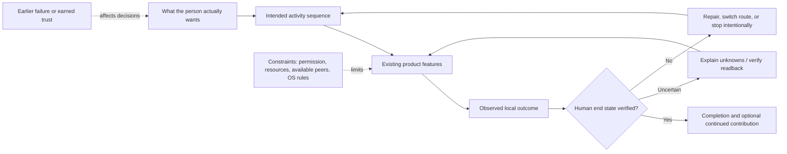

# Missing features in the BitTorrent ecosystem: human-centered conceptual synthesis

**Research date:** 2026-10-29  
**Evidence base:** desk research only; **no direct observation or interviews**.  
**Purpose:** identify potential feature-space gaps in an ecosystem inventory without confusing new user-facing compositions with entirely new protocol primitives.  
**Scope boundary:** external BitTorrent clients, remotes, seedbox tools, sidecars and adjacent workflows; **not** an assessment of Chunks' existing requirements or implementation.

**Source of record:** [240-feature ecosystem inventory](../BITTORRENT-ECOSYSTEM-FEATURE-INVENTORY-2026-10-29.md), [240-activity and 36-journey atlas](../BITTORRENT-USER-GOALS-AND-WORKFLOWS-2026-10-29.md), [multilingual avoidance/friction evidence](../BITTORRENT-USER-AVERSION-RESEARCH-2026-10-29.md), [concept map](BITTORRENT-HUMAN-CONCEPT-MAP-2026-10-29.md), [evidence disconfirmation audit](BITTORRENT-CONCEPT-MAP-EVIDENCE-AUDIT-2026-10-29.md), and [typed JSON graph](BITTORRENT-CONCEPT-GRAPH-2026-10-29.json).

## Executive interpretation

The existing **240-feature** external catalogue and **240-activity** atlas generated **69** initially proposed gap hypotheses. Three additional composite seams (**H70–H72**) were identified by desk synthesis, yielding **72** hypotheses. Treating these as independent missing features would double-count overlapping concerns. The present synthesis resolves them into **33 distinct, non-overlapping primary capability families** (`MF01`–`MF33`), and a separate representation of **30 cross-activity seams** (`SM01`–`SM30`).

**This is not a count of 33 inventions.** The audit found:

| Classification | Families | IDs |
|---|---:|---|
| Not explicitly integrated in the 240-feature list | 7 | MF02, MF04, MF18, MF20, MF24, MF31, MF32 |
| Documented partial implementations already exist | 8 | MF05, MF07, MF11, MF12, MF13, MF17, MF27, MF30 |
| Underlying capabilities present in inventory | 16 | MF01, MF03, MF06, MF08, MF09, MF10, MF14, MF15, MF16, MF19, MF21, MF22, MF23, MF25, MF26, MF33 |
| Platform-bounded problem, not a missing protocol primitive | 2 | MF28, MF29 |

Only **7** are currently **not explicitly integrated** as complete user-facing capabilities within the existing 240-feature list. This is the best available *inventory-coverage* measure, **not a claim that all existing applications lack them**. 8 are documented in significant part already, 16 combine existing primitives, and 2 are constrained by Android platform behavior. The 33 families were selected to represent separate human outcomes, not market demand or engineering priority. The detailed H series retains nuance; MF is the non-duplicated reporting layer.

## 1. Seven clearest possible omissions from the inventory

### MF02 · Goal-level completion receipt

**Why it could be missing:** Transfer completion is not equivalent to content arrival, import or usefulness.

**Candidate complete experience:** Show stages from submission to final verified user goal with appropriately uncertain readback.

**What already exists:** Existing RPC success and downstream import mechanisms cover pieces of the chain.

**Linked hypotheses:** H02, H16, H17, H44. **Human activities:** A08.04, A10.01, A12.02. **Evidence limitation:** No exhaustive product/version test has established that this capability is universally absent. The correct claim is that it is *not explicitly packaged as one integrated capability* in the earlier 240-feature reference.

### MF04 · Human-task resume after interruptions

**Why it could be missing:** Restoring the torrent session does not restore the person's unfinished intention.

**Candidate complete experience:** Offer a checkpoint of last decision, unresolved steps and verified state after reconnection.

**What already exists:** History/recent activity is present but context of the human goal is not explicit.

**Linked hypotheses:** H06, H27, H53. **Human activities:** A07.05, A04.10, A15.12. **Evidence limitation:** No exhaustive product/version test has established that this capability is universally absent. The correct claim is that it is *not explicitly packaged as one integrated capability* in the earlier 240-feature reference.

### MF18 · Evidence-based traffic route verification

**Why it could be missing:** VPN/proxy configuration does not prove every peer/tracker request took intended route.

**Candidate complete experience:** Show scope of tested network routes with limits and truthful uncertainty.

**What already exists:** VPN binding and proxy controls exist; full path proof is not implied.

**Linked hypotheses:** H32, H60. **Human activities:** A14.01, A14.02, A15.03. **Evidence limitation:** No exhaustive product/version test has established that this capability is universally absent. The correct claim is that it is *not explicitly packaged as one integrated capability* in the earlier 240-feature reference.

### MF20 · Creator-to-recipient availability proof

**Why it could be missing:** Creating and publishing metainfo does not prove recipients can retrieve bytes.

**Candidate complete experience:** Test seed reachability and support consensual confirmation of recipient delivery.

**What already exists:** Embedded trackers and torrent creation exist, but recipient outcome is separate.

**Linked hypotheses:** H37, H38. **Human activities:** A13.01, A13.10, A13.12. **Evidence limitation:** No exhaustive product/version test has established that this capability is universally absent. The correct claim is that it is *not explicitly packaged as one integrated capability* in the earlier 240-feature reference.

### MF24 · Version-family publishing continuity

**Why it could be missing:** Publishing version two has implications for discovery, old swarms and existing recipients.

**Candidate complete experience:** Link related releases, recipient migration and initial-seed continuity.

**What already exists:** Creation and metadata tags are present; relationship over successive releases is not explicit.

**Linked hypotheses:** H47. **Human activities:** A13.11, A13.07. **Evidence limitation:** No exhaustive product/version test has established that this capability is universally absent. The correct claim is that it is *not explicitly packaged as one integrated capability* in the earlier 240-feature reference.

### MF31 · Effective policy conflict explanation

**Why it could be missing:** Overlapping ratio, speed, queue, source and environment rules may disagree.

**Candidate complete experience:** Show effective rule, why it won, and side effects of changing precedence.

**What already exists:** Generic policy inheritance and rule engines exist, but this compound explanation is not explicit.

**Linked hypotheses:** H70. **Human activities:** A17.05, A11.10, A07.11. **Evidence limitation:** No exhaustive product/version test has established that this capability is universally absent. The correct claim is that it is *not explicitly packaged as one integrated capability* in the earlier 240-feature reference.

### MF32 · Status freshness and confidence provenance

**Why it could be missing:** Cached, acknowledged and observed remote states can be confused.

**Candidate complete experience:** Label status age, source and certainty at the point of decision or command retry.

**What already exists:** Offline cache, readback and status state are existing primitives.

**Linked hypotheses:** H71. **Human activities:** A08.08, A04.01, A15.12. **Evidence limitation:** No exhaustive product/version test has established that this capability is universally absent. The correct claim is that it is *not explicitly packaged as one integrated capability* in the earlier 240-feature reference.

## 2. Known substantial partial implementations: not novel as stated

The following eight families have examples of direct implementation in documented products or maintained ecosystems. Their residual interest is in completeness, scope or cross-app interoperability, not mere existence of the primitive.

| ID | Human-facing target | What the sources already demonstrate | Important remaining uncertainty |
|---|---|---|---|
| **MF05** | Verified payload/reference identity | qui/cross-seed have documented dependency-aware cleanup and data reuse. | Show safe reference ownership and real reclaimable storage, with explicit confidence limits. |
| **MF07** | Portable migration and restore proof | qui has documented previews and per-job backups; data movement remains separate. | Export portable job metadata and test real paths/bytes/config on destination. |
| **MF11** | Dry-run consequence preview | qui has documented dry-run automation and backup/cleanup previews. | Preview exact affected jobs, paths, policies and target before mutation. |
| **MF12** | Dependency-safe cleanup and recovery | qui provides cross-seed-aware/orphan safeguards; universal undelete not established. | Identify dependent seeds/libraries, protect bytes and define bounded undo. |
| **MF13** | Partial-operation compensating actions | qui verifies certain export registrations and reverts unhealthy target state. | Reconcile per-step effects and safely undo or resume only verified changes. |
| **MF17** | Remote connection and authority explanation | qui and client panels expose partial multi-instance setup/testing. | Test connection, capabilities, separate service permissions and actual execution scope. |
| **MF27** | Repair after version or UI regression | Release notes/setting import and targeted accessibility updates exist. | Explain changed behavior and preserve/recover task-specific workflow preferences. |
| **MF30** | Task-semantic accessibility parity | Specific accessibility defects have been reported; other apps show fixes. | Offer unambiguous status text and full assistive access to numerical data/actions. |

**Source-specific cautions:** In the [validation audit](BITTORRENT-CONCEPT-MAP-EVIDENCE-AUDIT-2026-10-29.md), qui demonstrates substantial cross-seed-aware operations, backups, restore previews and rule previews. Its **Export to Instance** deals with torrent registration and **does not move payload bytes**, with default target skip-checking. These are not grounds to label verified content delivery or universal undo as already solved. Similarly, Android permission choices and background service modes constrain local-client workflows regardless of desirable UX.

## 3. Composition opportunities built on known feature primitives

The next 16 families are **already represented in meaningful parts of the 240-item inventory**. The additional concept is a more complete or more cognitively coherent interaction. They should not be appended as wholly new independent protocol features without first checking whether the inventory needs a more precise subfeature or an explicit integration relationship.

| ID | Existing-primitives family | Specific proposed integration | Why counting it as a novel feature would be misleading |
|---|---|---|---|
| **MF01** | Intent-level task guidance | Explain choices with minimal setup, preserve an advanced manual route. | Cross-cutting help/onboarding controls exist; no verified universal intent-to-outcome route. |
| **MF03** | Resumable remote payload handoff | Provide an explicit, resumable data-retrieval handoff separate from torrent registration. | Remote file transfer, path mapping and server copy tools are inventory features. |
| **MF06** | Identity-preserving move/rename repair | Reconcile renamed/moved paths, verify hashes and explain consequences before/after changes. | Inventory already has rename, move, missing-file detection and recheck primitives. |
| **MF08** | Cause-to-action failure explanation | Rank supported causes and recovery choices, including honestly stopping a futile attempt. | Tracker diagnostics, logs and failure handling already appear in inventory. |
| **MF09** | Scarce-piece and availability judgment | Separate observed peer availability from inferred likelihood and provide honest uncertainty. | Piece maps, peer health and cross-seed lookup are established partial tools. |
| **MF10** | Use-ready file and target verification | Report readiness for a chosen file/target before claiming usable completion. | Preview, codec analysis and casting exist but not necessarily one verified path. |
| **MF14** | Actual-resource-aware plans | Explain sustainable transfer and seeding choices with budget and deadline assumptions. | Caps, rate schedules and provider quotas exist; demand/cost are external. |
| **MF15** | Actionable exception and rule explanation | Summarize actionable exceptions and state why a rule matched or acted. | Notifications, history and rule logs are existing primitives. |
| **MF16** | Temporary policy and multi-stage retention | Describe temporary speed, upload, retention and archive intents with explicit expiry. | Per-category policies, time windows and seeding stop rules already exist. |
| **MF19** | Destructive target and credential identity guard | Bind potentially destructive changes to a clearly verified server/tenant and privilege. | Profile identity, TLS certificates and deletion confirmation are inventory features. |
| **MF21** | Honest contribution and demand accounting | Explain low-demand seeding, obligations and contribution without blame. | Ratio/time stats and swarm health partially support this already. |
| **MF22** | Tracker-specific obligation preflight | Describe known tracker constraints before acquisition, with user-controlled correction. | Credential/rule support exists, actual site policies are external and vary. |
| **MF23** | Publisher authenticity and research provenance | Preserve provenance, publisher signatures and selected-file manifest. | Academic Torrents/versioning and checksum tools provide partial support. |
| **MF25** | Non-media purpose-aware processing | Offer explicit goal-relevant transforms and verification beyond media workflows. | Generic postprocessing, archives, checksum and scripts exist. |
| **MF26** | Meaningful consent and alternative-route choice | Explain statuses, permission and alternatives without moral pressure. | Help and multi-protocol fetching are already represented, broader human choice is a model. |
| **MF33** | Effective cross-layer capability explanation | Explain not merely whether a feature exists but why it works for the selected engine/storage/provider. | Capability probing and connection setup exist; combined scope may require cross-tool integration. |

## 4. Platform-bounded capabilities

| ID | Relationship to investigate | Relevant constraints | Limit of software control |
|---|---|---|---|
| **MF28** | Expose task-specific running/paused/retry semantics rather than promise perpetual background execution. | Long-running seeding intentions may conflict with OS service limits. | Android UIDT/FGS/WorkManager approaches exist with conditional limits. |
| **MF29** | Show available storage scopes, fix lost grants and prevent impossible destinations. | Save-path ability varies by OS version, permission grant and app distribution build. | SAF and variant-specific filesystem restrictions are platform facts. |

Android 15+ time limits apply to *specified types* of background foreground services, not to every torrent operation or Android version. Android 14+ UIDT, WorkManager and FGS each have different operational semantics; indefinite seeding cannot simply be promised through one mechanism. Storage access varies by Android version, permission state, destination and distribution package. See [Android primary-doc evidence V08–V14 and V25](BITTORRENT-CONCEPT-MAP-EVIDENCE-AUDIT-2026-10-29.md).

## 5. What the added activity seams reveal

The graph adds thirty **SM** nodes, each linking two known activities to a potential capability family. They are *causal possibilities*, not user journey telemetry. Many are alternative or concurrent operations rather than mandatory sequences.

| Seam | Where human purpose crosses a technical boundary | Representative weakness | Candidate family |
|---|---|---|---|
| SM01 | A01.02 → A02.01 | A result can be findable without being trustworthy or available | MF26 |
| SM02 | A02.01 → A03.01 | A job exists but file selection cannot yet happen | MF09 |
| SM03 | A03.02 → A05.02 | Selected media complete while site still expects full file or seed duration | MF22 |
| SM04 | A08.04 → A10.01 | Remote Add does not put bytes on controller phone | MF02 |
| SM05 | A10.01 → A10.08 | SFTP/sync job and torrent progress are independent | MF03 |
| SM06 | A04.09 → A12.02 | Finished data is not yet matched and playable in library | MF02 |
| SM07 | A06.07 → A15.02 | High seed count can hide missing rare pieces | MF09 |
| SM08 | A05.01 → A20.03 | Elapsed time need not earn bytes or tracker credit | MF21 |
| SM09 | A12.12 → A20.05 | Deleting a path may or may not free blocks; another consumer may need it | MF05 |
| SM10 | A10.03 → A16.01 | File identity and job mapping diverge after external move | MF06 |
| SM11 | A08.07 → A15.12 | Uncertain command result can cause dangerous blind retry | MF13 |
| SM12 | A11.07 → A15.12 | One action succeeds while later step fails | MF13 |
| SM13 | A17.01 → A20.05 | Reclaim decision must consider hardlinks and protected seeds | MF12 |
| SM14 | A13.02 → A13.10 | Torrent published but no recipient can receive data | MF20 |
| SM15 | A14.01 → A08.01 | Configured route can differ from effective traffic path | MF18 |
| SM16 | A04.12 → A20.11 | Human intent persists but Android scheduling may stop daemon | MF28 |
| SM17 | A10.11 → A16.11 | SAF permission and filename semantics may block repair | MF29 |
| SM18 | A18.07 → A04.01 | Focusable controls do not expose data and context reliably | MF30 |
| SM19 | A18.10 → A04.10 | Version or theme regression destroys familiar task flow | MF27 |
| SM20 | A01.12 → A02.01 | Best result may be not opening torrent client | MF26 |
| SM21 | A09.11 → A20.07 | Cancel can strand data, profile and torrent metadata | MF07 |
| SM22 | A07.09 → A11.09 | Overlapping conditions lead to unexplained effective policy | MF31 |
| SM23 | A08.08 → A04.01 | Stale cache looks like current server truth | MF32 |
| SM24 | A09.06 → A08.03 | Presence of app not equal to all RPC/file capabilities | MF33 |
| SM25 | A13.11 → A13.07 | Metadata for release family not connected to old seed/recipient | MF24 |
| SM26 | A16.09 → A16.05 | Restored registration doesn't guarantee new host bytes | MF07 |
| SM27 | A03.04 → A12.03 | Playable locally does not imply playable on selected TV | MF10 |
| SM28 | A11.10 → A20.05 | Rule outcome may violate hidden storage references | MF11 |
| SM29 | A01.07 → A14.10 | Good piece hashes are not malware or publisher authenticity checks | MF23 |
| SM30 | A17.04 → A17.05 | Session switch or timer may not reverse group limits as intended | MF31 |

### 5.1 Eight especially instructive junctions

| Cross-boundary goal | Activity chain | Families | Why the gap matters |
|---|---|---|---|
| Controller action → remote payload → usable local object | A08.04 → A10.01 → A12.02 | MF02 / MF03 | Remote Add, SFTP and media import may each succeed independently; only the final human outcome defines completion. |
| Torrent registration ↔ disk blocks ↔ library references | A12.12 → A17.02 → A20.05 | MF05 / MF12 | Job removal, a deleted filename and reclaimed bytes are different outcomes, especially with links. |
| Rules engine → resulting limits and retention | A07.09 → A11.09 → A17.05 | MF15 / MF31 | A rule's trigger, scope, precedence, exception and actual action may be scattered across multiple screens or apps. |
| Status cache → actual server state | A08.08 → A04.01 → A15.12 | MF02 / MF32 | A cached number or server acknowledgement can be mistaken for a recent verified readback. |
| Creator file → published torrent → real recipient | A13.02 → A13.10 → A13.12 | MF20 / MF24 | Metadata publication, initial seed reachability and receiver delivery are different stages. |
| Phone app visibility → Android engine continuity | A04.12 → A20.11 → A17.07 | MF28 / MF29 | Foreground UI, background execution policy and permission to reach storage change independently. |
| Wanted file → library / player → specific device | A03.08 → A12.01 → A12.03 | MF10 / MF25 | Torrent-wide and wanted-file completion, extractability and target codec readiness are different postconditions. |
| Participation intention → constrained resource budget | A05.01 → A17.03 → A20.02 | MF14 / MF21 | Low upload ratio can mean no peer demand, metering, limited uplink, or voluntary policy; not automatically unwillingness. |

## 6. Human cognitive and emotional relationships

These links distinguish **a feature's mechanic**, **the mental model it demands**, and **possible emotional stakes**. Emotions are conditional hypotheses and must not be assigned universally to every user.

| Human question | Cognitive load | Potential emotional stake | What an effective feature should clarify |
|---|---|---|---|
| “Where is my file?” | Distinguish job registration, server, phone, library and actual bytes | Confusion, disappointment, desire for agency | Location and verified delivery/readiness (MF02/MF03) |
| “Will this ever finish?” | Distinguish tracker-reported peers, currently connected peers, missing pieces | Anticipation, uncertainty, irritation | Evidence, limits and honest scarcity (MF09) |
| “Can I rename/delete this safely?” | Model links, disk blocks, torrent mappings and dependent consumers | Concern about irreversible loss | Consequence preview and protected references (MF05/MF06/MF12) |
| “Why is the speed different now?” | Recall active profiles, temporary overrides and competing rules | Perceived loss of control or annoyance | Effective policy and precedence (MF31) |
| “Did that remote command work?” | Interpret cached state, acknowledgement and postcondition | Anxiety about accidental double action | Freshness/readback/effect receipt (MF02/MF32) |
| “Am I really contributing?” | Compare upload demand, time online, ratio and resource limits | Pride, pressure, or perceived unfairness | Meaning of sharing outcome (MF21/MF22) |
| “Will this run when I close the phone?” | Predict Android process/service lifecycle separately from transfer state | Uncertainty, potential disappointment | Correct OS-authorized continuity claims (MF28) |
| “Can I use this with TalkBack or color differences?” | Extract numerical status and scope without visual inference | Exclusion, avoidable overload, confidence when accessible | Task-semantic parity, not decorative compliance (MF30) |
| “Should I use torrents for this?” | Compare alternative channels and risk, rather than assuming a client is always best | Reluctance, relief, curiosity | Informed choice, including non-use (MF26) |

## 7. Full consolidated catalogue and traceability

Each of the **72 H hypotheses is assigned to exactly one primary MF family**. That accounting prevents accidental inflation from wording variants and different stages of the same outcome. SM activity seams can point to a family without proving its novelty or demand.

| Family | Distinct capability | Inventory classification | Included hypotheses |
|---|---|---|---|
| **MF01** | Intent-level task guidance | component present | H01, H51, H54, H62 |
| **MF02** | Goal-level completion receipt | not explicitly integrated | H02, H16, H17, H44 |
| **MF03** | Resumable remote payload handoff | component present | H03, H04, H05 |
| **MF04** | Human-task resume after interruptions | not explicitly integrated | H06, H27, H53 |
| **MF05** | Verified payload/reference identity | documented partial implementation | H07, H08, H11, H12 |
| **MF06** | Identity-preserving move/rename repair | component present | H09, H22, H45 |
| **MF07** | Portable migration and restore proof | documented partial implementation | H10, H23, H61 |
| **MF08** | Cause-to-action failure explanation | component present | H13, H18, H63 |
| **MF09** | Scarce-piece and availability judgment | component present | H14, H25, H39 |
| **MF10** | Use-ready file and target verification | component present | H15, H43, H56 |
| **MF11** | Dry-run consequence preview | documented partial implementation | H19, H50 |
| **MF12** | Dependency-safe cleanup and recovery | documented partial implementation | H20, H21 |
| **MF13** | Partial-operation compensating actions | documented partial implementation | H24, H35 |
| **MF14** | Actual-resource-aware plans | component present | H26, H57, H65 |
| **MF15** | Actionable exception and rule explanation | component present | H28, H52 |
| **MF16** | Temporary policy and multi-stage retention | component present | H29, H30 |
| **MF17** | Remote connection and authority explanation | documented partial implementation | H31, H34 |
| **MF18** | Evidence-based traffic route verification | not explicitly integrated | H32, H60 |
| **MF19** | Destructive target and credential identity guard | component present | H33, H36 |
| **MF20** | Creator-to-recipient availability proof | not explicitly integrated | H37, H38 |
| **MF21** | Honest contribution and demand accounting | component present | H40, H58 |
| **MF22** | Tracker-specific obligation preflight | component present | H41, H59 |
| **MF23** | Publisher authenticity and research provenance | component present | H42, H46 |
| **MF24** | Version-family publishing continuity | not explicitly integrated | H47 |
| **MF25** | Non-media purpose-aware processing | component present | H48 |
| **MF26** | Meaningful consent and alternative-route choice | component present | H49, H55, H66 |
| **MF27** | Repair after version or UI regression | documented partial implementation | H64 |
| **MF28** | Android background continuity disclosure | platform bounded | H67 |
| **MF29** | Android destination capability and reauthorization | platform bounded | H68 |
| **MF30** | Task-semantic accessibility parity | documented partial implementation | H69 |
| **MF31** | Effective policy conflict explanation | not explicitly integrated | H70 |
| **MF32** | Status freshness and confidence provenance | not explicitly integrated | H71 |
| **MF33** | Effective cross-layer capability explanation | component present | H72 |

The [machine-readable graph](BITTORRENT-CONCEPT-GRAPH-2026-10-29.json) carries `consolidates_hypothesis` and `could_be_bridged_by` edges for complete, inspectable traceability. Existing F nodes and their 695 originally linked activities were not rewritten.

## 8. What should *not* be counted as a missing feature

A rigorous ultimate-feature inventory should exclude false novelty:

- **No peers / missing pieces:** software can detect uncertainty, suggest alternatives or help manage waiting. It cannot manufacture a file that nobody possesses.
- **Private tracker access / user credit:** an app cannot compel admission, enforce someone else's community policy, or guarantee sufficient demand for upload credit.
- **Legal rights and malware safety:** BitTorrent piece hashes are not proof of publisher identity, file safety, license or jurisdiction-specific authorization.
- **Universally unlimited Android background work:** OS policy is a capability boundary; claiming indefinite work without evaluating app/service type would be misinformation.
- **Pure preference/psychographic inventions:** users differ in tolerance for advanced controls, manual curation, automation, and willingness to seed. No one-size-fits-all “emotional feature” follows automatically.
- **Existing mechanics rephrased as new features:** FTP/SFTP access, file priority, ratio rules, recheck, hardlinks, cross-seeding, backups, dry-run and basic metadata preview already appear in the original inventory and/or primary implementation evidence.
- **Intentional stopping:** successfully downloading one file and leaving the client is a legitimate completed workflow, not proof of abandonment friction.

## 9. Desk-only follow-up to strengthen the inventory without user studies

There is no requirement to collect user telemetry, recruit people or conduct interviews. Within the bounds of publicly accessible sources and the existing research, the highest-information next checks are:

1. **Feature-level precision audit:** For the seven `not_explicitly_integrated` MF items, search product code/documentation/changelogs for explicit completed user-facing flows, not merely component APIs. Record exact versions and support scope.
2. **Scope-and-proof matrix:** For the eight `documented_partial_implementation` items, distinguish supported operation, required filesystem permissions, actual readback verification, and whether underlying bytes were independently validated.
3. **Failure-mode crosswalk:** Connect user complaints from the aversion atlas to a stage and to evidence of implementation, rather than deriving a new feature from every complaint.
4. **Platform compatibility revision:** Keep Android version/service/installer mode and remote engine capabilities separate. A client may display a control but lack permission to execute it.
5. **Negative space test:** Search mature maintenance tooling, shell-oriented clients, protocols and automation sidecars for examples whose existence **falsifies** an apparently missing feature.
6. **Counterfactual outcome audit:** For each new “feature” idea ask: *What can the person now verify or recover that they could not previously?* If no specific state transition changes, it may be UX vocabulary or a relationship rather than a discrete new capability.

**No market prevalence, financial value, user satisfaction improvement, or product-level implementation priority can be computed from the evidence currently available.** Confidence relates to the existence of supporting examples, not predicted product success.

## 10. Scope and conclusion

This research is exploratory and non-normative. It does not rank Chunks feature implementation, compare existing Chunks contracts, write product requirements, or claim newly proposed capabilities have been user-validated. The actual research finding is **a smaller and more defensible capability-space hypothesis set** than a raw list of 72.

**Summary:** 240 existing feature concepts → 72 research hypotheses → 33 consolidated human-outcome capability families → **7 not explicitly integrated in the inventory**, **8 with documented implementation precedents**, **16 compositions of existing primitives**, and **2 substantially platform-bounded questions**. The 30 workflow seams make it possible to explore each family through concrete human interactions rather than abstract feature names.
